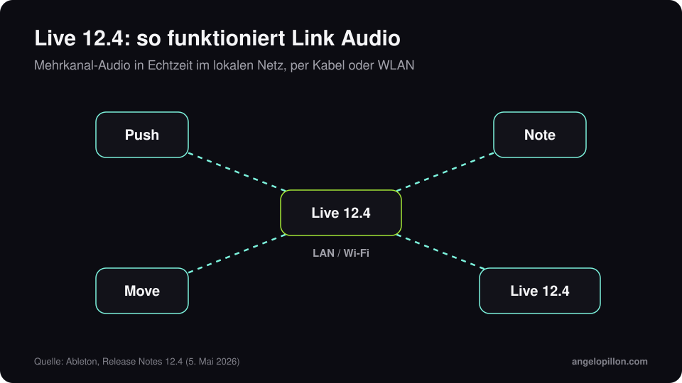

Kurz gesagt
<ul>
<li>Live 12.4 ist am 5. Mai 2026 erschienen, kostenlos für Besitzer von Live 12.</li>
<li>Link Audio streamt Mehrkanal-Audio in Echtzeit zwischen kompatiblen Geräten im lokalen Netz, per Kabel oder WLAN.</li>
<li>In Live Suite arbeitet die Stem-Trennung auf einer Zeitauswahl und kann Stems zu einem einzigen Clip zusammenfassen.</li>
</ul>

Ableton Link synchronisiert seit Jahren Tempo und Phase zwischen Apps und Geräten. Mit Version 12.4 überträgt es auch Audio.

<figure><figcaption>Link Audio im lokalen Netz. Eigene Grafik.</figcaption></figure>

<!-- SCREENSHOT ANGELO: Live 12.4 mit aktivem Link Audio oder das neue Erosion -->

## Die Neuerungen

- **Link Audio**: Audio von Move, Note, Push oder einem anderen Rechner mit Live erscheint als Eingang, ohne zusätzliche Hardware und ohne manuelle Latenzkompensation.
- **Stem-Trennung** (Suite): arbeitet jetzt auf einer Auswahl in der Arrangement-Ansicht, sodass 16 Takte zu isolieren nicht mehr den ganzen Track erfordert. Ausgewählte Stems lassen sich zu einem Clip zusammenfassen.
- **Aktualisierte Devices**: ein neu gebautes Erosion, ein neuer LFO mit Zeitmodi und Wellenformen im Delay sowie Updates für Chorus-Ensemble und Wavetable.
- **Learn View** mit Lektionen direkt in Live und **Quick Tags** im Browser.
- **Move 2.0 und Note 2.0** sind zusammen mit 12.4 erschienen, mit Audiospuren und Link Audio.

## Was es bedeutet, wenn du Spuren zum Mischen gibst

Die Trennung auf einer Auswahl ist praktisch, um ein Sample aus einem gedruckten Loop zu retten. Wenn du Spuren für einen Engineer vorbereitest, bleibt die Regel aber gleich: aus den Originalspuren exportieren, kreative Effekte gedruckt, nichts auf dem Master. Ich habe einen Leitfaden zum [Vorbereiten von Stems](/de/artikel/stems-vorbereiten) geschrieben, und für das Low End im Techno den Artikel über [Low End im Melodic Techno](/de/artikel/low-end-melodic-techno).

<blockquote class="pull">Aus einem Mix getrennte Stems sind ein Kompromiss. Aus der Session exportierte Stems sind ein Mix, der darauf wartet zu entstehen.</blockquote>

Du produzierst in Ableton und willst einen Mix, der für Beatport und Spotify bereit ist? <a class="cta" href="/de/#contact">Schreib mir</a>

## Quellen

- [Ableton, Live 12.4 ist da](https://www.ableton.com/de/blog/live-12-4-is-out-now/)
- [Ableton, What’s new in Live 12.4](https://help.ableton.com/hc/en-us/articles/26963870210076-What-s-new-in-Live-12-4)
