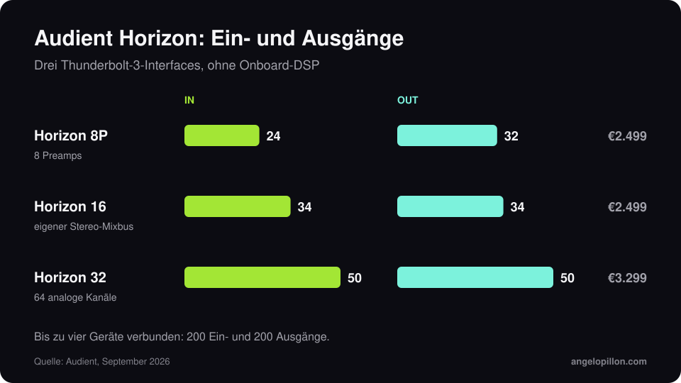

Kurz gesagt
<ul>
<li>Am 14. September 2026 angekündigt, ist die Horizon-Serie seit 28. September erhältlich.</li>
<li>Drei Thunderbolt-3-Modelle: Horizon 8P für Aufnahmen, Horizon 16 für Hybridstudios, Horizon 32 für große Studios.</li>
<li>32-Bit-Wandlung, Roundtrip-Latenz unter 1 ms, kein Onboard-DSP. Preise von 2.499 € bis 3.299 €.</li>
</ul>

Audient nennt es die größte Investition in Forschung und Entwicklung der Firmengeschichte. Die Grundidee: Macs mit Apple Silicon sind schnell genug, um native Plug-ins mit niedriger Latenz zu betreiben, ein proprietäres DSP-Ökosystem ist also nicht mehr nötig.

<figure><figcaption>Ein- und Ausgänge der drei Modelle. Eigene Grafik.</figcaption></figure>

## Die drei Modelle

| Modell | I/O | Für | Preis |
|---|---|---|---|
| Horizon 8P | 24 in / 32 out | Aufnahmen, 8 Preamps mit variabler ORBIT-Impedanz und 75 dB Gain | 2.499 € |
| Horizon 16 | 34 in / 34 out | Hybridstudios, 32 Kanäle über DB25 und eigener Stereo-Mixbus-Weg | 2.499 € |
| Horizon 32 | 50 in / 50 out | große Studios, 64 analoge Kanäle über acht DB25 | 3.299 € |

Alle sind lüfterlose 1HE-Geräte mit digitalem Recall der Eingangsverstärkung, BNC-Wordclock-Ein- und -Ausgang, ADAT-Erweiterung und wählbaren Referenzpegeln. Bis zu vier Geräte lassen sich verketten, für maximal 200 Ein- und 200 Ausgänge. Die Garantie beträgt drei Jahre. Die Steuersoftware ist für macOS.

## Was es für Hybrid-Mastering bedeutet

Am meisten interessiert mich der eigene Mixbus-Weg am Horizon 16. Wer analoge Kompressoren und EQs einschleift, braucht saubere Wandlung hin und zurück und eine Möglichkeit, die Pegel ans Outboard anzupassen. Das ist dasselbe Thema wie im Artikel über [Hybrid- vs. ITB-Mastering](/de/artikel/hybrid-vs-itb-mastering).

Trotzdem ist der Wandler in den meisten Homestudios nicht der Engpass. Zuerst kommen Raum und Abhöre.

<blockquote class="pull">Der beste Wandler der Welt korrigiert keinen Raum, der bei 80 Hz dröhnt.</blockquote>

Du willst ein Hybrid-Mastering mit analoger Kette und digitaler Kontrolle? <a class="cta" href="/de/#contact">Schreib mir</a>

## Quellen

- [Audient, Horizon](https://audient.com/)
- [Sound On Sound, Audient Horizon](https://www.soundonsound.com/news/audient-unveil-flagship-horizon-interfaces)
