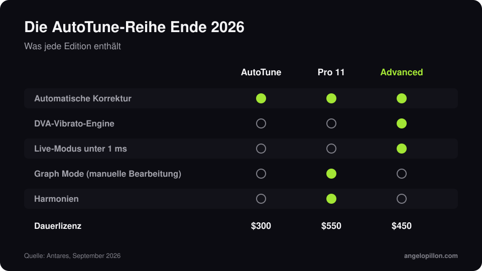

Kurz gesagt
<ul>
<li>AutoTune Advanced ist Ende September 2026 erschienen und steht jetzt an der Spitze von Antares’ automatischer Reihe.</li>
<li>Die DVA-Engine erkennt das natürliche Vibrato und erhält es auch bei starker Korrektur. Der Live-Modus läuft mit unter 1 ms Latenz.</li>
<li>Die Dauerlizenz kostet 450 $. Graph Mode und Harmonien bleiben bei AutoTune Pro 11.</li>
</ul>

AutoTune wird seit jeher vorgeworfen, Vocals zu glätten: Wenn die Korrektur schnell ist, wird auch das Vibrato zur geraden Linie. AutoTune Advanced soll genau das lösen.

<figure><figcaption>Die AutoTune-Reihe Ende 2026. Eigene Grafik.</figcaption></figure>

<!-- SCREENSHOT ANGELO: AutoTune Advanced auf einer Stimme, mit der Vibrato-Anzeige -->

## Die Neuerungen

- **DVA**: eine zum Patent angemeldete Vibrato-Engine, die einen Tonhöhenfehler von einer Entscheidung des Sängers unterscheidet. Das Vibrato lässt sich erhalten, reduzieren oder betonen.
- **Live-Modus**: unter 1 ms Latenz von 44,1 bis 192 kHz, nützlich bei Aufnahmen und live.
- **Formant und Transpose**, eine visuelle Tastatur mit 78 Tasten, MIDI-Steuerung über MIDI Perform und Integration mit AutoKey 2.
- **Signature-Presets** von Produzenten und Engineers wie Ann Mincieli, Bart Schoudel und David „Yungin“ Kim.

## Welche Edition passt

| Edition | Für | Preis |
|---|---|---|
| AutoTune (2026) | automatische Korrektur im Alltag | 300 $ |
| AutoTune Pro 11 | manuelle Bearbeitung im Graph Mode, Harmonien | 550 $ |
| AutoTune Advanced | natürliche automatische Korrektur, live | 450 $ |

Alle sind im Abo AutoTune Unlimited enthalten.

## Was es für den Mix bedeutet

In Rap und Trap ist AutoTune Teil des Sounds, und ich behandle es als Effekt. In Pop und R&B muss es unsichtbar bleiben, und dort macht ein erhaltenes Vibrato einen riesigen Unterschied. Ein Tipp für jede Version: Schick mir immer auch die unkorrigierte Stimme. Wenn die gedruckte Korrektur nicht überzeugt, kann ich sie neu machen. Mehr dazu im Artikel über [Rap- und Trap-Vocals mit AutoTune](/de/artikel/rap-trap-vocals-autotune).

Du hast eine Stimme mit AutoTune zum Mischen? Schick mir die korrigierte und die saubere Spur. <a class="cta" href="/de/#contact">Schreib mir</a>

## Quellen

- [Antares, AutoTune Advanced](https://www.antarestech.com/)
- [Mix, AutoTune Advanced debuts](https://www.mixonline.com/technology/news-products/autotune-advanced-pitch-correction-plug-in-debuts)
