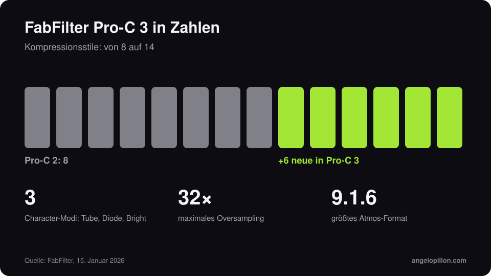

Kurz gesagt
<ul>
<li>Pro-C 3 ist am 15. Januar 2026 erschienen.</li>
<li>Sechs neue Stile für insgesamt 14, dazu drei Character-Modi: Tube, Diode und Bright.</li>
<li>Auto Threshold, bis zu 32-faches Oversampling, Atmos-Unterstützung bis 9.1.6. Preis 169 €.</li>
</ul>

Pro-C 2 war jahrelang in unzähligen Sessions der Standard-Kompressor: transparent, wenn nötig, mit eigenen Stilen für Vocals, Busse und Mastering. Pro-C 3 behält die Oberfläche und erweitert die Möglichkeiten.

<figure><figcaption>Pro-C 3 in Zahlen. Eigene Grafik.</figcaption></figure>

<!-- SCREENSHOT ANGELO: Pro-C 3 auf einem Bus oder einer Stimme deiner Session -->

## Die Neuerungen

- **14 Kompressionsstile**, sechs mehr als Pro-C 2.
- **Character**: drei Sättigungsmodi, Tube, Diode und Bright, um direkt im Kompressor Farbe hinzuzufügen.
- **Auto Threshold**: Der Threshold folgt dem Signalpegel, sodass die Kompression konstant bleibt, während du den Eingangspegel änderst.
- **Bis zu 32-faches Oversampling** und **Atmos-Unterstützung bis 9.1.6**.
- Etwa zur selben Zeit hat Pro-Q 4.10 die Instance List erhalten, um alle offenen Instanzen in einem Fenster zu sehen und zu bearbeiten.

## Wie ich ihn einsetze

Bei Vocals kann ich mit einem schnellen Stil und aktivem Auto Threshold den Pegel ändern, ohne die Kompression neu einzustellen. Auf dem Mixbus bevorzuge ich einen langsamen Stil mit wenigen dB Reduktion: Details im Artikel über [Mixbus-Kompression](/de/artikel/mixbus-kompression). Die Character-Modi sind praktisch, aber Vorsicht: Sie fügen Obertöne hinzu, und in einem Mix, in dem du schon anderswo sättigst, summieren sie sich.

<blockquote class="pull">Ein neuer Kompressor rettet keine schlecht komprimierte Stimme. Ein guter lässt eine gut komprimierte Stimme leicht aussehen.</blockquote>

Du willst eine präsente, kontrollierte Stimme, die nicht gequetscht klingt? <a class="cta" href="/de/#contact">Schreib mir</a>

## Quellen

- [FabFilter](https://www.fabfilter.com/)
