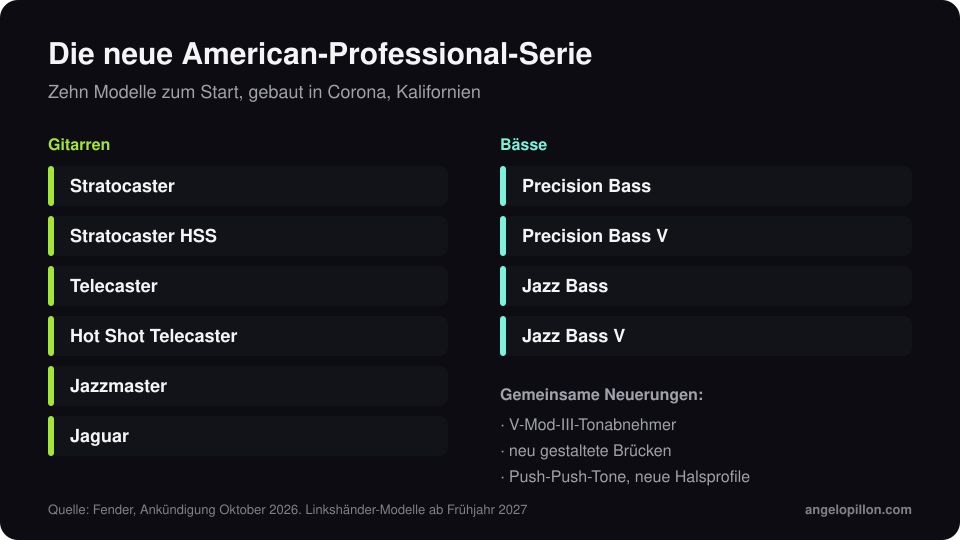

Kurz gesagt
<ul>
<li>Im Oktober 2026 angekündigt, ersetzt die neue American Professional die American Professional II und verzichtet auf die Nummerierung.</li>
<li>V-Mod-III-Tonabnehmer, neu gestaltete Brücken, ClassicGear-Precision-Potis, Push-Push-Tonregler und überarbeitete Halsprofile.</li>
<li>Zehn Modelle zum Start, gebaut in Corona, Kalifornien. Linkshänder-Versionen kommen im Frühjahr 2027.</li>
</ul>

Fender hat sich gegen den Namen American Professional III entschieden. Die neue Serie heißt einfach American Professional und folgt auf die II von 2020.

<figure><figcaption>Das Angebot zum Start. Eigene Grafik.</figcaption></figure>

<!-- SCREENSHOT/FOTO ANGELO: deine eigene Gitarre oder dein Bass im Studio, wenn du magst -->

## Was sich ändert

- **V-Mod-III-Tonabnehmer**, die nächste Generation der Pickups der Serie.
- **Neu gestaltete Brücken** an allen Modellen.
- **ClassicGear-Precision-Potis** und **Push-Push-Tonregler**, die mehr Klangoptionen bieten, ohne die Optik des Instruments zu ändern.
- **Überarbeitete Halsprofile.**

## Die Modelle

Gitarren: Stratocaster, Stratocaster HSS, Telecaster, Hot Shot Telecaster, Jazzmaster und Jaguar. Bässe: Precision Bass, Precision Bass V, Jazz Bass und Jazz Bass V. Alle gebaut im Werk in Corona, Kalifornien.

## Was es für Aufnahmen bedeutet

Ein neues Instrument macht einen Mix nicht von allein besser, aber ein paar Dinge helfen dem, der danach mischt, wirklich:

- **Frische Saiten und geprüfte Intonation.** Ein Bass, der in hohen Lagen verstimmt ist, ist das häufigste Low-End-Problem, das ich behebe, und kein EQ kann das korrigieren.
- **Nimm auch ein sauberes DI-Signal auf.** Bei Gitarre und Bass bitte ich immer um die direkte Spur zusätzlich zur Amp- oder Amp-Sim-Spur: Das lässt im Mix andere Entscheidungen zu.
- **Keine gedruckten Effekte, wenn sie nicht Teil des Sounds sind.** Hall und Delay lassen sich im Mix besser steuern, wie ich im Artikel über [Hall und Delay](/de/artikel/hall-und-delay-im-mix) erkläre.

<blockquote class="pull">Neue Pickups hört man. Einen schlecht intonierten Bass hört man mehr.</blockquote>

Gitarre und Bass aufgenommen und du willst einen Mix, der ihnen Luft gibt? <a class="cta" href="/de/#contact">Schreib mir</a>

## Quellen

- [Fender, American Professional](https://www.fender.com/)
