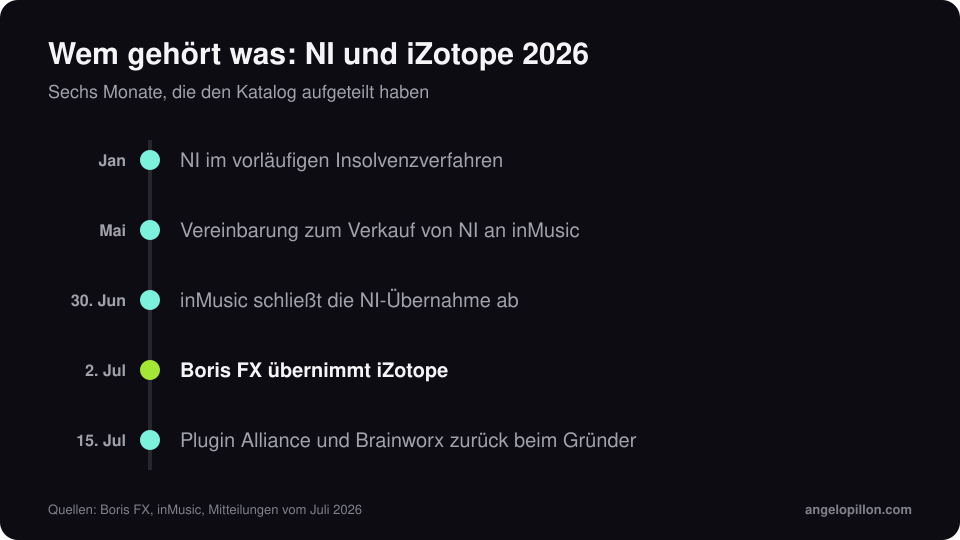

Kurz gesagt
<ul>
<li>Am 2. Juli 2026 hat Boris FX die Übernahme von iZotope bekannt gegeben.</li>
<li>Der Deal war mit der Übernahme von Native Instruments durch inMusic abgestimmt, die am 30. Juni abgeschlossen wurde.</li>
<li>Lizenzen, Abos und Support für Ozone, RX, Neutron und Nectar bleiben aktiv.</li>
</ul>

Es war ein bewegtes Jahr für eine der größten Gruppen im Audio-Software-Markt. Native Instruments, zu der seit 2023 iZotope, Plugin Alliance und Brainworx gehörten, ging im Januar in ein vorläufiges Insolvenzverfahren. Im Mai wurde der Verkauf an inMusic vereinbart. Dann wurde der Katalog aufgeteilt.

<figure><figcaption>Sechs Monate, die den Katalog aufgeteilt haben. Eigene Grafik.</figcaption></figure>

## Wem gehört was

- **Native Instruments** (Kontakt, Komplete, Maschine): inMusic.
- **iZotope** (Ozone, RX, Neutron, Nectar): Boris FX, das im März 2026 bereits Vegas Pro, Sound Forge und Acid Pro von MAGIX gekauft hatte.
- **Plugin Alliance und Brainworx**: seit 15. Juli wieder beim Gründer von Brainworx, in einer neuen Gruppe zusammen mit Apogee und Manley.

## Was sich für Ozone- und RX-Nutzer ändert

Praktisch vorerst nichts. Boris FX und iZotope haben bestätigt, dass Lizenzen und Abos aktiv bleiben und die Entwicklungs- und Support-Teams an Bord bleiben. iZotope arbeitet als Geschäftsbereich innerhalb von Boris FX. Die letzten Releases sind RX 12 im April 2026 und Ozone 12 im September 2025, mit dem IRC-5-Limiter.

Mein üblicher Rat gilt in solchen Momenten doppelt: Bewahr die Installer und Lizenzschlüssel der Versionen auf, die du nutzt, und exportier deine wichtigen Presets.

## Meine Sicht

Ozone ist ein hervorragendes Werkzeug, und sein Mastering-Assistent ist ein guter Ausgangspunkt. Aber ein Plug-in entscheidet nicht, wie laut ein Track sein soll oder ob der Bass für das Genre zu viel ist. Mehr dazu in [Wie laut sollte ein Master sein](/de/artikel/wie-laut-sollte-ein-master-sein).

Du hast Ozones Assistenten ausprobiert und bist nicht überzeugt? Schick mir das Premaster, ich sage dir, wie ich es mastern würde. <a class="cta" href="/de/#contact">Schreib mir</a>

## Quellen

- [Boris FX, Pressemitteilung vom 2. Juli 2026](https://blog.borisfx.com/press/boris-fx-acquires-izotope-the-award-winning-leader-in-intelligent-audio-technology)
- [MusicTech, iZotope joins Boris FX](https://musictech.com/news/izotope-joins-boris-fx-exits-native-instruments/)
- [CDM, wem nach NI was gehört](https://cdm.link/ni-after-ni-which-brand-is-where-and-who-owns-whom/)
