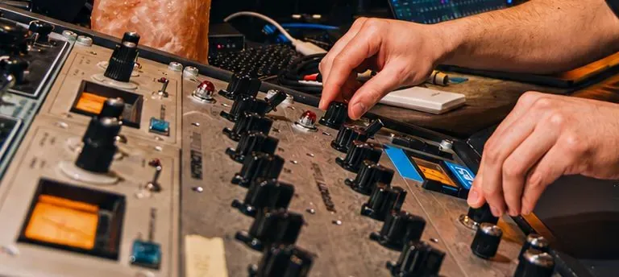

Kurz gesagt
<ul>
<li>2025 überschritten die Vinylverkäufe in den USA zum ersten Mal seit 1983 eine Milliarde Dollar: 46,8 Millionen Platten.</li>
<li>Vinyl ist nicht „originalgetreuer“ als eine verlustfreie Datei. Es ist anders, mit eigenem Klang, eigenen Grenzen und eigenem Ritual.</li>
<li>Oft klingt eine Platte besser, weil sie einen eigenen, weniger komprimierten Vinyl-Master hat.</li>
</ul>

Laut dem Jahresbericht der RIAA sind die Vinylverkäufe in den USA das neunzehnte Jahr in Folge gewachsen, 2025 um 9,3 Prozent, und machen inzwischen fast die Hälfte des weltweiten Formatwerts aus. Vinyl brachte mehr als dreimal so viel Umsatz wie die CD.

<figure><figcaption>Die analoge Technik im Studio: Hier entsteht ein Teil des „warmen“ Klangs. Foto aus dem Studio.</figcaption></figure>

## Was Vinyl besser macht

**Der Master.** Viele Platten bekommen einen eigenen Master, weniger zusammengedrückt als der fürs Streaming. Deshalb kann Vinyl dynamischer und offener klingen. Das Verdienst liegt bei der Entscheidung, nicht beim Medium.

**Das Hören.** Nadel auflegen, eine ganze Seite hören, das Cover anschauen. Du hörst aufmerksamer, und Aufmerksamkeit verändert alles.

## Was Vinyl schlechter macht

**Tiefe Bässe.** Sehr tiefe Frequenzen müssen in der Mitte liegen und dürfen nicht zu laut sein, sonst springt die Nadel.

**Höhen und Zischlaute.** Laute „S“-Laute verzerren, und zur Plattenmitte hin nimmt die Detailauflösung ab.

**Rauschen.** Knistern, Staub und Kratzer gehören zum Charme, nicht zur Klangtreue.

| | Vinyl | Lossless-Streaming |
|---|---|---|
| Treue zum Original | hoch, mit physikalischen Grenzen | identisch mit der Master-Datei |
| Dynamik | oft größer dank eigenem Master | hängt vom Master ab |
| Grundrauschen | vorhanden | keins |
| Erlebnis | Ritual, Objekt, Cover | Komfort, endloser Katalog |

<blockquote class="pull">Vinyl klingt nicht besser, weil es Vinyl ist. Es klingt besser, wenn jemand entschieden hat, dass es besser klingen soll.</blockquote>

Ein Vinyl-Master ist eine eigene Aufgabe: Bässe in der Mitte, kontrollierte Zischlaute, Seitenlängen. Was sich gegenüber Streaming ändert, erfährst du in den Artikeln über [analoges Mastering](/de/artikel/analoges-mastering) und [Master-Lieferformate](/de/artikel/master-lieferformate).

Du presst deine Platte? Ein Vinyl-Master braucht andere Entscheidungen. Lass uns reden. <a class="cta" href="/de/#contact">Schreib mir</a>

## Quellen

- [RIAA, Bericht 2025](https://www.riaa.com/riaa-reports-us-recorded-music-annual-revenue-achieves-new-high-of-11-5-billion-in-2025/)
- [AnalogPlanet](https://www.analogplanet.com/content/riaa-reports-us-vinyl-sales-surpassed-1-billion-2025-representing-nearly-50-our-favorite)
- [The Music Network](https://themusicnetwork.com/news/taylor-swift-drove-us-vinyl-sales-to-a-record-high-last-year)
