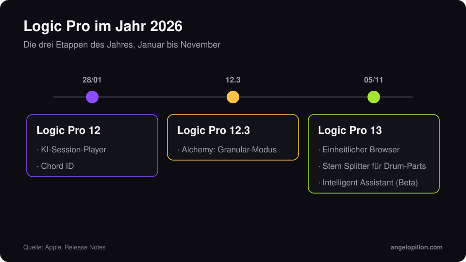

Kurz gesagt
<ul>
<li>Logic Pro 13 ist seit 5. November 2026 verfügbar, kostenlos für bestehende Logic-Nutzer und Creator-Studio-Abonnenten.</li>
<li>Die wichtigsten Neuerungen: einheitlicher Browser mit Sound-Tags direkt auf dem Mac, Stem Splitter für einzelne Drum-Parts und der Intelligent Assistant als Beta.</li>
<li>Voraussetzung ist ein Mac mit Apple Silicon und macOS 26.1 oder neuer.</li>
</ul>

Apple hat das November-Update von Creator Studio am 27. Oktober angekündigt. Am 5. November folgte Logic Pro 13, das zweite große Release des Jahres nach Logic Pro 12 im Januar.

<figure><figcaption>Die drei Etappen von Logic Pro im Jahr 2026. Eigene Grafik.</figcaption></figure>

<!-- SCREENSHOT ANGELO: Logic Pro 13, einheitlicher Browser mit Sound-Tags -->

## Die Neuerungen

**Einheitlicher Browser.** Loops, Samples, Presets und Patches findest du in einem einzigen Panel. Logic analysiert die Sounds direkt auf dem Mac und vergibt automatisch Tags, sodass auch eigene Libraries nach Charakter und Instrument durchsuchbar werden.

**Stem Splitter für Drums.** Die Trennung hört nicht mehr bei Vocals, Drums, Bass und Rest auf: Jetzt lassen sich auch einzelne Drum-Elemente wie Kick, Snare und Becken isolieren.

**Intelligent Assistant (Beta).** Ein KI-Assistent, der Fragen beantwortet und bei Aufgaben in der Session hilft. Er ist nur im Creator-Studio-Abo enthalten.

Wie die deutsche Fachpresse angemerkt hat, bringt Version 13 keine neuen Instrumente oder Effekte: Es ist ein Workflow-Update.

<!-- SCREENSHOT ANGELO: Stem Splitter mit Drums aufgeteilt in Kick, Snare, Becken -->

## Preis und Voraussetzungen

| | |
|---|---|
| Veröffentlichung | 5. November 2026 |
| Einmalkauf | 199,99 $ |
| Creator Studio | ab 12,99 $ pro Monat |
| Update | kostenlos für bestehende Logic-Pro-Nutzer |
| Voraussetzungen | Apple Silicon, macOS 26.1 oder neuer |

## Was es für Mixing und Mastering bedeutet

Der Stem Splitter für Drums ist nützlich, aber mit Bedacht einzusetzen. Wenn mir ein Produzent einen gedruckten Drum-Loop schickt und ich mehr Kontrolle über die Kick brauche, ist die Trennung ein guter Ausgangspunkt. Die Originalspuren ersetzt sie aber nicht: Wenn du sie hast, schick mir die. Trennungsartefakte, die im Kopfhörer kaum auffallen, werden deutlich, sobald im Mastering der Pegel steigt.

<blockquote class="pull">Einen Drum-Loop aufzutrennen ist ein Rettungsring, keine Methode. Die Originalspuren sind immer die bessere Wahl.</blockquote>

Bevor du mitten in einem Projekt aktualisierst, schließ die Session in der Version ab, in der du sie begonnen hast. Prüf deine Plug-ins und mach eine Kopie des Projekts, derselbe Rat wie beim [Exportieren von Spuren für Mixing und Mastering](/de/artikel/spuren-exportieren-fuer-mixing-und-mastering).

Du arbeitest in Logic und willst einen Mix oder Master, der fürs Streaming bereit ist? Schick mir das Projekt oder die Spuren. <a class="cta" href="/de/#contact">Schreib mir</a>

## Quellen

- [Apple, Logic Pro](https://www.apple.com/de/logic-pro/)
- [Apple Newsroom](https://www.apple.com/de/newsroom/)
