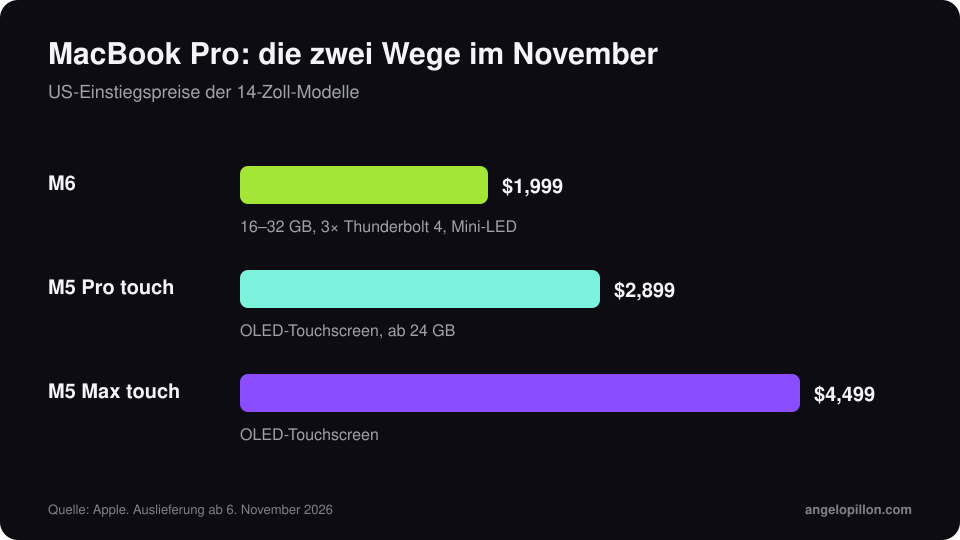

Kurz gesagt
<ul>
<li>14-Zoll-MacBook-Pro mit M6: 12-Kern-CPU, 16 bis 32 GB Speicher, drei Thunderbolt-4-Anschlüsse, ab 1.999 $.</li>
<li>MacBook Pro mit Touchscreen: OLED-Display, M5 Pro oder M5 Max, ab 2.899 $ als 14-Zoll-Modell.</li>
<li>Beide kommen mit macOS 27 Golden Gate: Prüf DAW, Plug-ins und Treiber, bevor du sie für bezahlte Arbeit nutzt.</li>
</ul>

Ende Oktober hat Apple zwei MacBook-Pro-Modelle im Abstand von einem Tag vorgestellt. Beide werden seit 6. November 2026 ausgeliefert.

<figure><figcaption>US-Einstiegspreise, 14-Zoll-Modelle. Eigene Grafik.</figcaption></figure>

## MacBook Pro M6

- 12-Kern-CPU, zwei Kerne mehr als M5.
- 16 bis 32 GB gemeinsamer Arbeitsspeicher, bis zu 170 GB/s Bandbreite.
- 1 TB Basisspeicher, drei Thunderbolt-4-Anschlüsse, HDMI, SD-Slot, Kopfhörerbuchse.
- Ab 1.999 $: 400 $ mehr als das Basis-M5, dafür doppelter Speicher.

## MacBook Pro mit Touchscreen

Es ist der erste Mac mit Touchscreen. Er nutzt ein OLED-Panel und dieselben M5-Pro- und M5-Max-Chips wie die Modelle vom März, die weiter verkauft werden. Die Preise beginnen bei 2.899 $ (14 Zoll, M5 Pro) und 3.399 $ für das 16-Zoll-Modell. In Logic Pro dient der Bildschirm als Keyboard, Pads und Bedienoberfläche.

<!-- SCREENSHOT ANGELO: falls du es ausprobierst, Logic Pro mit Touch-Steuerung -->

## Drei Prüfungen vor dem Kauf

1. **Kompatibilität mit macOS 27.** Neue Macs kommen mit Golden Gate und lassen sich in der Regel nicht auf eine ältere Version zurücksetzen. Pro Tools zum Beispiel unterstützt es offiziell noch nicht.
2. **Ältere Plug-ins.** Manche brauchen noch Rosetta 2, das das System nicht von selbst installiert.
3. **Eine echte Session am ersten Tag.** Öffne ein komplettes Projekt mit allen Plug-ins, die du nutzt, und halte den alten Mac bereit, bis alles bestätigt ist.

## Was für den Mix wirklich zählt

Für Mixing und Mastering ist der Prozessor weniger wichtig, als viele denken. Abhöre, Raum und Audio-Interface zählen mehr. Bevor du 2.000 € in einen Laptop steckst, lies meinen Leitfaden zum [Homestudio-Budget](/de/artikel/homestudio-budget): Die Investition, die deinen Sound am meisten verändert, liegt oft woanders.

<blockquote class="pull">Ein schnellerer Mac macht den Mix nicht schöner. Er macht das Warten kürzer.</blockquote>

Du willst nicht den Rechner wechseln, um die Platte fertigzustellen? Schick mir die Spuren, ich übernehme Mixing und Mastering. <a class="cta" href="/de/#contact">Schreib mir</a>

## Quellen

- [Apple Newsroom](https://www.apple.com/de/newsroom/)
- [Production Expert, M6 MacBook Pro für Audio](https://www.production-expert.com/production-expert-1/apple-m6-macbook-pro-what-audio-pros-need-to-know-before-ordering)
