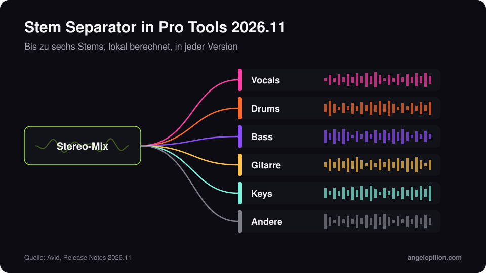

Kurz gesagt
<ul>
<li>Pro Tools 2026.11 ist Anfang November 2026 erschienen.</li>
<li>Extensions sind ein neues Format, getrennt von AAX, für Tools, die in Pro Tools laufen, ohne auf einer Spur zu sitzen.</li>
<li>Der Stem Separator teilt eine Datei in bis zu sechs Stems, rechnet lokal und ist in jeder Version enthalten.</li>
</ul>

Avid hatte die Extensions auf der IBC 2026 als Vorschau gezeigt. Mit Version 2026.11 werden sie öffentlich, zusammen mit eingebauter Stem-Trennung und Unterstützung für MIDI Polyphonic Expression.

<figure><figcaption>Der Stem Separator in Pro Tools 2026.11. Eigene Grafik.</figcaption></figure>

<!-- SCREENSHOT ANGELO: Extensions-Panel in Pro Tools 2026.11 -->

## Die Neuerungen

- **Extensions**: ein Format für Library-Browser, Kollaborationsdienste und Automatisierungen. In der ersten Welle sind Avids Stem Separator, Pro Sound Effects, Forte, Soundly und Pibox dabei. Auch Splice und SoundFlow erscheinen jetzt als Extensions.
- **Stem Separator**: bis zu sechs Stems (Vocals, Drums, Bass, Gitarre, Keys, Andere), berechnet auf deinem Rechner, ohne Upload. In jeder Version enthalten.
- **MPE**: Jede Note eines Akkords kann eigene Tonhöhe, Klangfarbe und Druck haben, mit eigenen Lanes im Edit Window und in den MIDI-Editoren.
- **Windows**: native Skalierung für QHD- und UHD-Displays und ein dunkles Theme, das jetzt auch Menüs und Titelleisten abdeckt.
- **Automatisch eingefärbte alternative Takes**, mit einer ID, die Playlist-Änderungen übersteht.

## Verfügbarkeit und Voraussetzungen

Das Update ist kostenlos für Abonnenten, für Besitzer einer Dauerlizenz mit aktivem Upgrade Plan und für Nutzer von Pro Tools Intro. Es läuft auf macOS Sonoma 14.8, Sequoia 15.7 und Tahoe 26.6 sowie auf Windows 11. Unterstützung für macOS 27 Golden Gate ist für ein späteres Release geplant: Wenn du gerade einen neuen Mac gekauft hast, prüf das vor der Installation.

## Was es für Mixing und Mastering bedeutet

Fast jede große DAW hat jetzt eine eingebaute Stem-Trennung. Für alle, die mit Kunden arbeiten, heißt das praktisch: Es kommen mehr Sessions mit Stems, die aus einem Stereo-Mix gewonnen wurden. Für einen Remix oder eine Skizze reicht das, für einen finalen Mix deutlich weniger. Wenn du Stems an einen Engineer schickst, sag immer dazu, ob sie aus einem Mix getrennt oder aus den Originalspuren exportiert wurden. Mehr dazu in meinem Leitfaden zum [Vorbereiten von Stems](/de/artikel/stems-vorbereiten).

Du hast eine Pro-Tools-Session zum Mischen? Exportier die Spuren und schick sie mir, ich melde mich mit Zeitplan und Angebot. <a class="cta" href="/de/#contact">Schreib mir</a>

## Quellen

- [Avid, Pro Tools: What’s New](https://www.avid.com/pro-tools/whats-new)
- [Production Expert, Pro Tools 2026.11](https://www.production-expert.com/production-expert-1/pro-tools-2026-11-adds-extensions-built-in-stem-separation-and-mpe)
