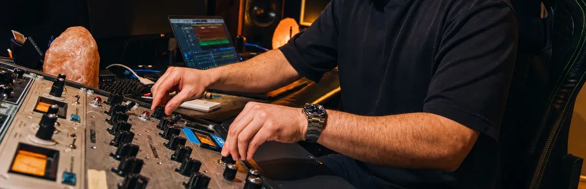

Kurz gesagt
<ul>
<li>TheMachine von Analog Obsession ist kostenlos über Patreon erhältlich, als VST3, AU und AAX für Mac und Windows.</li>
<li>CHOW Tape ist Open Source, entstanden als physikalisches Modell der Sony TC-260 und heute flexibler.</li>
<li>Fürs Mastering und für bestimmte Maschinen mit Kalibrierung bleiben kostenpflichtige Emulationen die bessere Wahl.</li>
</ul>

Band fügt Obertöne hinzu, rundet Transienten ab und gibt dem Bass Dichte. In meiner Mastering-Kette steckt eine echte Bandmaschine; im Mix nutze ich oft Emulationen, Spur für Spur.

<figure><figcaption>Die analoge Kette im Studio, Band inklusive. Foto aus dem Studio.</figcaption></figure>

## Der Vergleich

| | TheMachine | CHOW Tape |
|---|---|---|
| Preis | kostenlos | kostenlos, Open Source |
| Geschwindigkeit | 7,5 und 15 ips | mehr Optionen |
| Regler | Input, Drive, Output, Speed, Wow & Flutter, Noise, Bias | viele Parameter des physikalischen Modells |
| Formate | VST3, AU, AAX Native und AudioSuite | auch CLAP und LV2 |
| Vorbild | nicht genannt | basiert auf der Sony TC-260 |

**TheMachine.** Der Eingang ist pegelkompensiert, du kannst den Drive also ohne Lautstärkesprünge aufdrehen; der Ausgang ist sauber. Das Rauschen reicht von -120 bis -40 dB. Selten bei Gratis-Plug-ins: Es gibt auch AudioSuite für Pro Tools.

**CHOW Tape.** Mehr Parameter, mehr Maschinen- und Bandtypen. Es braucht mehr Zeit, reicht aber von dezent bis Lo-Fi.

## So würde ich sie einsetzen

Auf Drums und Bass hält ein Hauch Band die Transienten zusammen, ohne Kompressor. Bei digitalen Synths nimmt es die Schärfe. TheMachine ist perfekt, wenn du schnell entscheiden willst; CHOW Tape, wenn du einen bestimmten Charakter suchst. Vom Master würde ich sie fernhalten: Dort brauchst du benannte, kalibrierte und berechenbare Maschinen.

<blockquote class="pull">Band hörst du nicht, wenn du es einschaltest. Du hörst es, wenn du es wegnimmst.</blockquote>

Wie viel Sättigung du wo brauchst, steht im Leitfaden zur [Sättigung in Mix und Master](/de/artikel/saettigung-im-mix-und-master).

Du willst echtes Band auf deinem Master? Es steckt in meiner analogen Kette. <a class="cta" href="/de/#contact">Schreib mir</a>

## Quellen

- [Production Expert, TheMachine](https://www.production-expert.com/production-expert-1/analog-obsession-releases-themachine-a-free-tube-driven-tape-emulation)
- [The Beat Community, TheMachine](https://thebeatcommunity.com/2026/10/26/analog-obsession-release-themachine-a-free-download/)
- [CHOW Tape Model auf GitHub](https://github.com/jatinchowdhury18/AnalogTapeModel)
