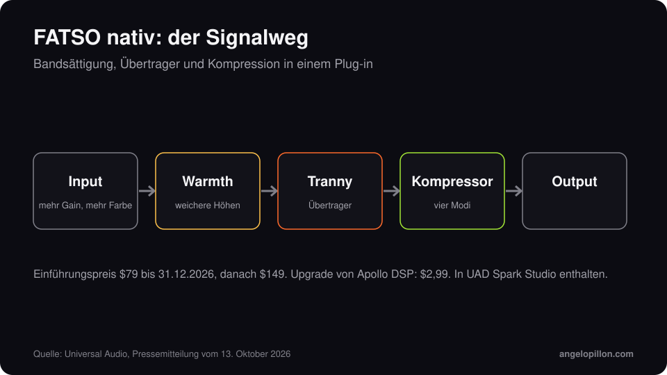

Kurz gesagt
<ul>
<li>Am 13. Oktober 2026 hat Universal Audio den nativen Empirical Labs FATSO veröffentlicht, mit FATSO Jr und FATSO Sr.</li>
<li>Kein Apollo-Interface und keine UAD-2-Karte mehr nötig: Er läuft auf macOS und Windows in jeder DAW.</li>
<li>Einführungspreis 79 $ bis 31. Dezember 2026, danach 149 $. Upgrade von Apollo DSP für 2,99 $. In UAD Spark Studio enthalten.</li>
</ul>

Der FATSO, Full Analog Tape Simulator and Optimizer, ist ein Prozessor von Empirical Labs, entworfen von Dave Derr. Er vereint bandartige Sättigung, Übertragerfarbe und Kompression in einem Gerät. Universal Audio hat das Plug-in gemeinsam mit Derr entwickelt.

<figure><figcaption>Der Signalweg, vereinfacht. Eigene Grafik.</figcaption></figure>

<!-- SCREENSHOT ANGELO: nativer FATSO auf einem Bus deiner Session -->

## So funktioniert er

- **Input**: Je stärker du ihn anfährst, desto mehr Sättigung. Er verhält sich wie weiches Limiting, ohne das Gefühl eines klassischen Kompressors.
- **Warmth**: macht die Höhen weicher, so wie Magnetband bei heißem Signal.
- **Tranny**: fügt Übertragerfarbe hinzu, vor allem im Bass.
- **Kompressor**: vier Modi, von sanfter Kontrolle bis zu deutlicher Verdichtung.

## So würde ich ihn einsetzen

Auf dem Drum-Bus, mit Warmth auf halber Stellung, nimmt er den Becken die Schärfe und hält Kick und Snare zusammen. Am Bass hilft der Übertrager, damit er auch auf kleinen Lautsprechern hörbar bleibt. Im Mastering setze ich ihn sehr vorsichtig ein: Sättigung verändert die Klangfarbe des ganzen Tracks, und was solo warm klingt, kann neben den Referenzen dumpf wirken.

Wann Sättigung hilft und wann sie schadet, erkläre ich im Artikel über [Sättigung im Mix und Master](/de/artikel/saettigung-im-mix-und-master).

<blockquote class="pull">Gute Sättigung bemerkt man nicht. Man bemerkt sie, wenn man sie wegnimmt.</blockquote>

Du willst einen Mix mit mehr Charakter, ohne Dynamik zu verlieren? <a class="cta" href="/de/#contact">Schreib mir</a>

## Quellen

- [Universal Audio, Pressemitteilung vom 13. Oktober 2026](https://www.uaudio.com/blogs/press/now-native-ua-releases-empirical-labs-fatso-tape-simulator-plug-ins)
