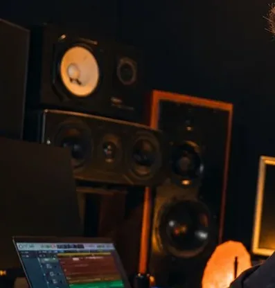

Kurz gesagt
<ul>
<li>Jedes System hat Grenzen: Handys geben keine tiefen Bässe wieder, das Auto bläht sie auf, Kopfhörer schirmen ab und rücken alles näher.</li>
<li>Fahrgeräusche und die Position der Lautsprecher im Auto verändern die Balance eines Tracks.</li>
<li>Ein guter Mix und Master sind darauf gebaut, zu „übersetzen“: überall gut klingen, nicht auf einem System perfekt.</li>
</ul>

„Im Studio klang es super, im Auto nicht.“ Den Satz höre ich am häufigsten. Und genau deshalb prüfe ich jeden Track auf mehreren Systemen, bevor ich ihn liefere.

<figure class="fig-small"><figcaption>Mehrere Monitorpaare, um den Track so zu hören, wie andere ihn hören werden. Foto aus dem Studio.</figcaption></figure>

## Was auf jedem System passiert

**Handy.** Die Lautsprecher sind winzig: Unterhalb einer bestimmten Frequenz geben sie fast nichts wieder. Kick und Bass hörst du nur über ihre Obertöne, die höheren Frequenzen, die sie erzeugen.

**Auto.** Der Innenraum ist klein und geschlossen, manche tiefen Frequenzen dröhnen. Motor- und Reifengeräusche überdecken Details und tiefe Klänge. Die Lautsprecher sitzen unten und seitlich, das Stereobild verschiebt sich.

**Kopfhörer.** Sie schirmen Außengeräusche ab, jedes Detail wirkt näher. Aber jedes Ohr hört nur seinen Kanal, das Stereobild wirkt breiter, als es ist.

**Lautsprecher im Wohnzimmer.** Der Raum fügt Reflexionen hinzu und verstärkt manche Töne mehr als andere.

| System | Typisches Problem | Was der Mix sichern muss |
|---|---|---|
| Handy | Bass verschwindet | Obertöne bei Kick und Bass |
| Auto | dröhnende Bässe, Lärm | kontrollierter Bass, klare Stimme |
| Kopfhörer | übertriebenes Stereo | gute Monokompatibilität |
| Wohnzimmer | Raumdröhnen | tonale Balance |

<blockquote class="pull">Ein guter Mix klingt nirgends perfekt. Er klingt überall gut.</blockquote>

## Wie ich arbeite

Ich höre auf großen und kleinen Monitoren, auf Kopfhörern, in Mono und auf einem kleinen Lautsprecher. Ich prüfe, ob die Stimme auch mit Hintergrundgeräusch vorne bleibt, ob der Bass am Handy durchkommt und ob der Track in Mono hält. Mehr in den Artikeln über [Phase und Monokompatibilität](/de/artikel/phase-und-mono-kompatibilitaet) und über [Referenztracks](/de/artikel/referenztracks).

Dein Track klingt nur auf deiner eigenen Anlage gut? Ich sorge dafür, dass er überall gut klingt. <a class="cta" href="/de/#contact">Schreib mir</a>

