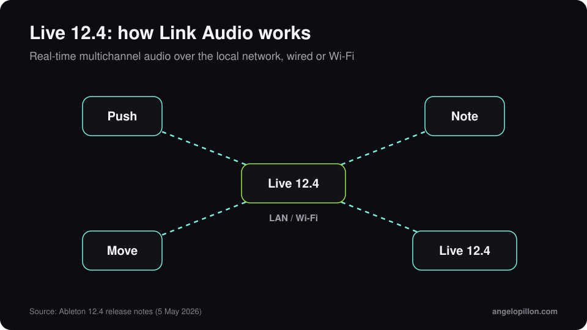

In short
<ul>
<li>Live 12.4 was released on 5 May 2026, free for Live 12 owners.</li>
<li>Link Audio streams multichannel audio in real time between compatible devices on the local network, wired or over Wi-Fi.</li>
<li>In Live Suite, stem separation works on a time selection and can combine stems into a single clip.</li>
</ul>

Ableton Link has synced tempo and phase between apps and devices for years. With version 12.4 it carries audio too.

<figure><figcaption>Link Audio on the local network. Original graphic.</figcaption></figure>

<!-- SCREENSHOT ANGELO: Live 12.4 with Link Audio enabled or the new Erosion -->

## What’s new

- **Link Audio**: audio from Move, Note, Push or another computer running Live shows up as an input, with no extra hardware and no manual latency compensation.
- **Stem separation** (Suite): now works on a selection in Arrangement View, so isolating 16 bars no longer means processing the whole track. Chosen stems can be combined into a single clip.
- **Updated devices**: a rebuilt Erosion, a new LFO with time modes and waveforms in Delay, and updates to Chorus-Ensemble and Wavetable.
- **Learn View** with lessons inside Live, and **Quick Tags** in the browser.
- **Move 2.0 and Note 2.0** shipped alongside 12.4, with audio tracks and Link Audio.

## What it means if you send tracks out to be mixed

Separating a selection is handy for rescuing a sample from a printed loop. But when you prepare tracks for an engineer, the rule does not change: export from the original tracks, with creative effects printed and nothing on the master bus. I wrote a [stem preparation guide](/stem-preparation-guide), and for techno low end there is the one on [low end in melodic techno](/low-end-melodic-techno-mixing).

<blockquote class="pull">Stems separated from a mix are a compromise. Stems exported from the session are a mix waiting to happen.</blockquote>

Producing in Ableton and want a mix ready for Beatport and Spotify? <a class="cta" href="/#contact">Get in touch</a>

## Sources

- [Ableton, Live 12.4 is out now](https://www.ableton.com/en/blog/live-12-4-is-out-now/)
- [Ableton, What’s new in Live 12.4](https://help.ableton.com/hc/en-us/articles/26963870210076-What-s-new-in-Live-12-4)
