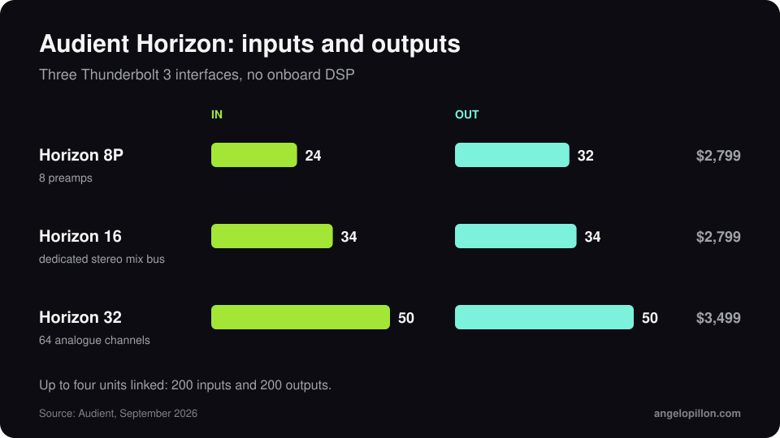

In short
<ul>
<li>Announced on 14 September 2026, the Horizon range has been on sale since 28 September.</li>
<li>Three Thunderbolt 3 models: Horizon 8P for tracking, Horizon 16 for hybrid studios, Horizon 32 for large facilities.</li>
<li>32-bit conversion, sub-millisecond round-trip latency, no onboard DSP. Prices from $2,799 to $3,499.</li>
</ul>

Audient calls it the largest R&D investment in its history. The idea behind it: Apple silicon Macs are fast enough to run native plug-ins at low latency, so a proprietary DSP ecosystem is no longer needed.

<figure><figcaption>Inputs and outputs of the three models. Original graphic.</figcaption></figure>

## The three models

| Model | I/O | For | Price |
|---|---|---|---|
| Horizon 8P | 24 in / 32 out | tracking, 8 preamps with ORBIT variable impedance and 75 dB of gain | $2,799 |
| Horizon 16 | 34 in / 34 out | hybrid studios, 32 channels on DB25 and a dedicated stereo mix-bus path | $2,799 |
| Horizon 32 | 50 in / 50 out | large facilities, 64 analogue channels on eight DB25 | $3,499 |

All are fanless 1U units with digital recall of input gains, BNC word clock in and out, ADAT expansion and selectable reference levels. Up to four units can be chained, for a maximum of 200 inputs and 200 outputs. The warranty is three years. The control software is for macOS.

## What it means for hybrid mastering

The detail I care about most is the dedicated mix-bus path on Horizon 16. Anyone inserting analogue compressors and EQs needs clean conversion out and back in, and a way to calibrate levels to the outboard. It is the same topic as the article on [hybrid vs in-the-box mastering](/hybrid-vs-itb-mastering).

That said, the converter is not the bottleneck in most home studios. The room and the monitoring come first.

<blockquote class="pull">The best converter in the world will not fix a room that booms at 80 Hz.</blockquote>

Want hybrid mastering with an analogue chain and digital control? <a class="cta" href="/#contact">Get in touch</a>

## Sources

- [Audient, Horizon](https://audient.com/)
- [Sound On Sound, Audient Horizon](https://www.soundonsound.com/news/audient-unveil-flagship-horizon-interfaces)
