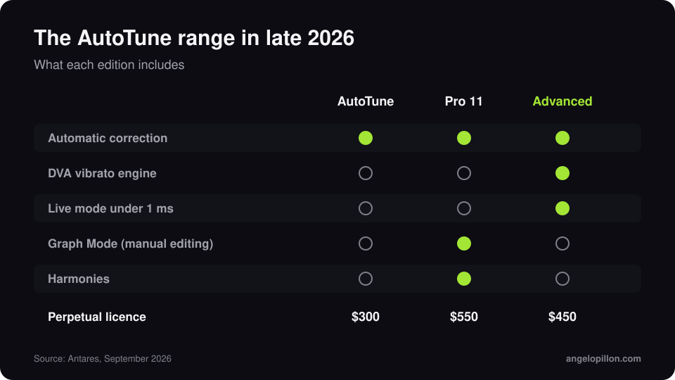

In short
<ul>
<li>AutoTune Advanced was released in late September 2026 and now tops Antares’ automatic range.</li>
<li>The DVA engine recognises the singer’s natural vibrato and keeps it, even with hard correction. Live mode runs under 1 ms of latency.</li>
<li>It costs $450 as a perpetual licence. Graph Mode and harmonies stay on AutoTune Pro 11.</li>
</ul>

AutoTune has always been accused of flattening vocals: when correction is fast, vibrato turns into a straight line. AutoTune Advanced is built to fix exactly that.

<figure><figcaption>The AutoTune range in late 2026. Original graphic.</figcaption></figure>

<!-- SCREENSHOT ANGELO: AutoTune Advanced on a vocal, with the vibrato display -->

## What’s new

- **DVA**: a patent-pending vibrato engine that tells a pitch error from a singer’s choice. Vibrato can be preserved, reduced or emphasised.
- **Live mode**: under 1 ms of latency from 44.1 to 192 kHz, useful for tracking and live shows.
- **Formant and transpose**, a 78-key visual keyboard, MIDI control through MIDI Perform and AutoKey 2 integration.
- **Signature presets** from producers and engineers including Ann Mincieli, Bart Schoudel and David “Yungin” Kim.

## Which one to choose

| Edition | For | Price |
|---|---|---|
| AutoTune (2026) | everyday automatic correction | $300 |
| AutoTune Pro 11 | manual editing in Graph Mode, harmonies | $550 |
| AutoTune Advanced | natural automatic correction, live | $450 |

All of them are included in the AutoTune Unlimited subscription.

## What it means for the mix

In rap and trap, AutoTune is part of the sound and I treat it as an effect. In pop and R&B it needs to be invisible, and that is where preserved vibrato makes a huge difference. One tip that applies to every version: always send me the untuned vocal too. If the printed tuning does not convince, I can redo it. More in the article on [rap and trap vocals with AutoTune](/rap-trap-vocals-autotune).

Got a tuned vocal to mix? Send me the tuned track and the clean one. <a class="cta" href="/#contact">Get in touch</a>

## Sources

- [Antares, AutoTune Advanced](https://www.antarestech.com/)
- [Mix, AutoTune Advanced debuts](https://www.mixonline.com/technology/news-products/autotune-advanced-pitch-correction-plug-in-debuts)
