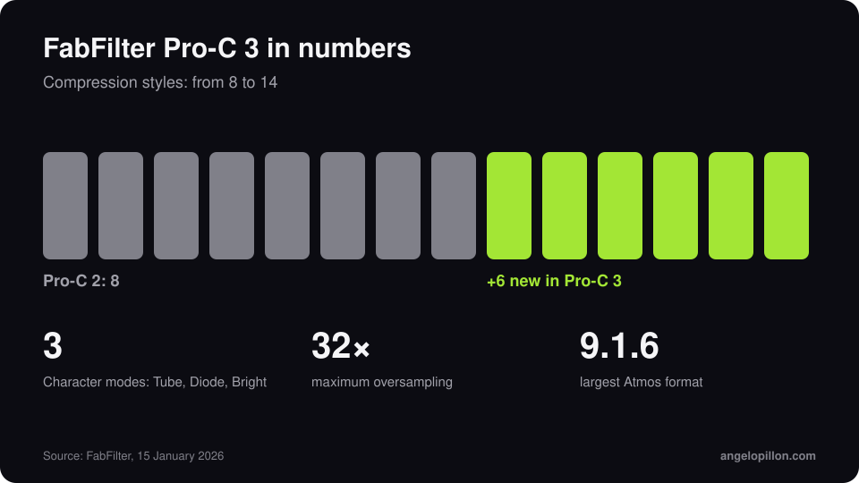

In short
<ul>
<li>Pro-C 3 was released on 15 January 2026.</li>
<li>Six new styles for a total of 14, plus three Character modes: Tube, Diode and Bright.</li>
<li>Auto Threshold, up to 32x oversampling, Atmos support up to 9.1.6. Price $199.</li>
</ul>

For years Pro-C 2 was the default compressor in countless sessions: transparent when needed, with different styles for vocals, buses and mastering. Pro-C 3 keeps the interface and widens the range.

<figure><figcaption>Pro-C 3 in numbers. Original graphic.</figcaption></figure>

<!-- SCREENSHOT ANGELO: Pro-C 3 on a bus or vocal in your session -->

## What’s new

- **14 compression styles**, six more than Pro-C 2.
- **Character**: three saturation modes, Tube, Diode and Bright, to add colour inside the compressor.
- **Auto Threshold**: the threshold follows the signal level, so the amount of compression stays steady while you change the input gain.
- **Up to 32x oversampling** and **Atmos support up to 9.1.6**.
- Around the same time, Pro-Q 4.10 added the Instance List, to see and edit every open instance in one window.

## How I use it

On vocals, a fast style with Auto Threshold on lets me change the gain without rebalancing the compression. On the mix bus I prefer a slow style with a few dB of reduction: details in the article on [mix bus compression](/mix-bus-compression). The Character modes are handy, but careful: they add harmonics, and in a mix where you already saturate elsewhere they stack up.

<blockquote class="pull">A new compressor will not save a badly compressed vocal. A good one makes a well compressed vocal look easy.</blockquote>

Want a vocal that is present and controlled without sounding squashed? <a class="cta" href="/#contact">Get in touch</a>

## Sources

- [FabFilter](https://www.fabfilter.com/)
