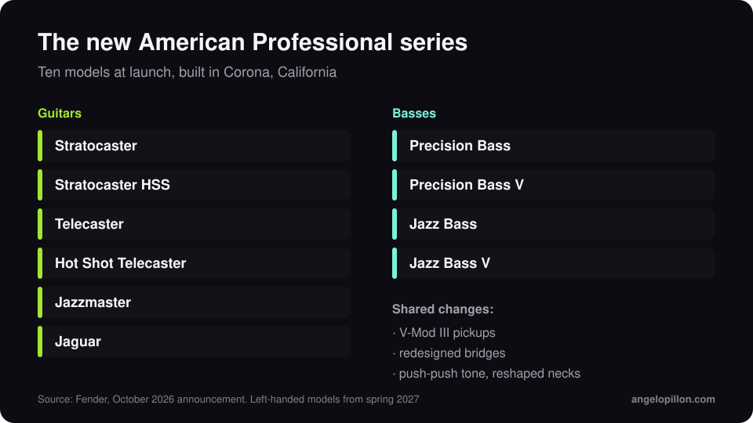

In short
<ul>
<li>Announced in October 2026, the new American Professional replaces the American Professional II and drops the numbering.</li>
<li>V-Mod III pickups, redesigned bridges, ClassicGear Precision pots, push-push tone controls and reshaped neck profiles.</li>
<li>Ten models at launch, built in Corona, California. Left-handed versions arrive in spring 2027.</li>
</ul>

Fender chose not to call it the American Professional III. The new series is simply American Professional, and it takes over from the II, which launched in 2020.

<figure><figcaption>The launch line-up. Original graphic.</figcaption></figure>

<!-- SCREENSHOT/PHOTO ANGELO: your own guitar or bass in the studio, if you like -->

## What changes

- **V-Mod III pickups**, the next generation of the series’ pickups.
- **Redesigned bridges** across the range.
- **ClassicGear Precision pots** and **push-push tone controls**, which add tonal options without changing the look of the instrument.
- **Reshaped neck profiles.**

## The models

Guitars: Stratocaster, Stratocaster HSS, Telecaster, Hot Shot Telecaster, Jazzmaster and Jaguar. Basses: Precision Bass, Precision Bass V, Jazz Bass and Jazz Bass V. All built at the Corona, California factory.

## What it means if you record

A new instrument does not improve a mix on its own, but a few things really help whoever mixes it:

- **Fresh strings and checked intonation.** A bass that goes out of tune up the neck is the most common low-end problem I fix, and no EQ can correct it.
- **Record a clean DI as well.** With guitar and bass I always ask for the direct track alongside the amp or amp-sim track: it leaves room for different choices in the mix.
- **No printed effects unless they are part of the sound.** Reverb and delay are better handled in the mix, as I explain in the article on [reverb and delay](/reverb-and-delay-in-the-mix).

<blockquote class="pull">You can hear new pickups. You hear a badly intonated bass more.</blockquote>

Recorded guitar and bass and want a mix that lets them breathe? <a class="cta" href="/#contact">Get in touch</a>

## Sources

- [Fender, American Professional](https://www.fender.com/)
