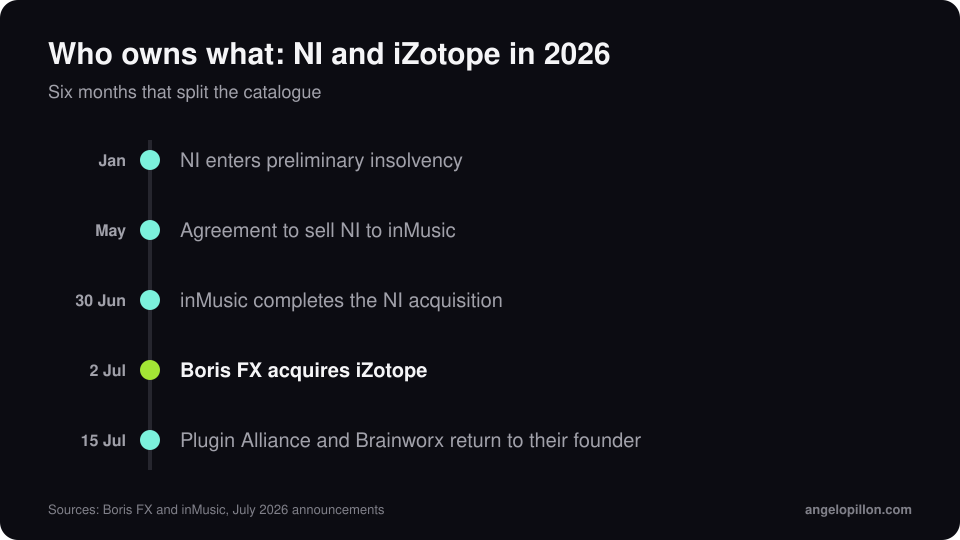

In short
<ul>
<li>On 2 July 2026 Boris FX announced its acquisition of iZotope.</li>
<li>The deal was coordinated with inMusic’s acquisition of Native Instruments, completed on 30 June.</li>
<li>Licences, subscriptions and support for Ozone, RX, Neutron and Nectar remain active.</li>
</ul>

It has been a busy year for one of the largest groups in audio software. Native Instruments, which since 2023 had included iZotope, Plugin Alliance and Brainworx, entered preliminary insolvency proceedings in January. In May an agreement to sell it to inMusic was announced. Then the catalogue split.

<figure><figcaption>Six months that split the catalogue. Original graphic.</figcaption></figure>

## Who owns what

- **Native Instruments** (Kontakt, Komplete, Maschine): inMusic.
- **iZotope** (Ozone, RX, Neutron, Nectar): Boris FX, which had already bought Vegas Pro, Sound Forge and Acid Pro from MAGIX in March 2026.
- **Plugin Alliance and Brainworx**: since 15 July back with Brainworx’s founder, in a new group alongside Apogee and Manley.

## What changes for Ozone and RX users

Nothing practical for now. Boris FX and iZotope have confirmed that licences and subscriptions stay active and that the development and support teams remain in place. iZotope runs as a business unit within Boris FX. The latest releases are RX 12, in April 2026, and Ozone 12, in September 2025, with the IRC 5 limiter.

The advice I always give counts double at times like this: keep the installers and licence keys for the versions you use, and export your important presets.

## My take

Ozone is an excellent tool, and its mastering assistant is a good starting point. But a plug-in does not decide how loud a track should be, or whether the bass is too much for the genre. I cover that in [how loud should your master be](/how-loud-should-your-master-be).

Tried Ozone’s assistant and not convinced? Send me the premaster and I will tell you how I would master it. <a class="cta" href="/#contact">Get in touch</a>

## Sources

- [Boris FX press release, 2 July 2026](https://blog.borisfx.com/press/boris-fx-acquires-izotope-the-award-winning-leader-in-intelligent-audio-technology)
- [MusicTech, iZotope joins Boris FX](https://musictech.com/news/izotope-joins-boris-fx-exits-native-instruments/)
- [CDM, who owns what after NI](https://cdm.link/ni-after-ni-which-brand-is-where-and-who-owns-whom/)
