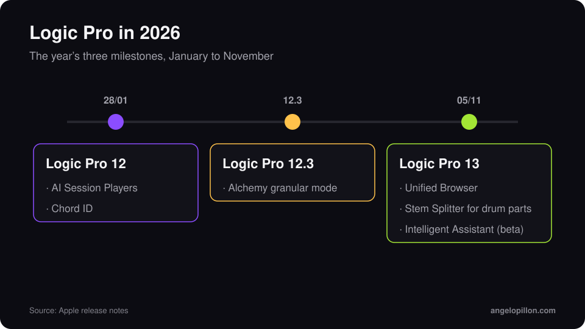

In short
<ul>
<li>Logic Pro 13 has been available since 5 November 2026, free for existing Logic owners and Creator Studio subscribers.</li>
<li>The headline features: a unified browser with on-device sound tagging, Stem Splitter for individual drum parts and the Intelligent Assistant beta.</li>
<li>It needs an Apple silicon Mac running macOS 26.1 or later.</li>
</ul>

Apple announced the November Creator Studio update on 27 October. Logic Pro 13 followed on 5 November, the year’s second major release after Logic Pro 12 in January.

<figure><figcaption>Logic Pro’s three milestones in 2026. Original graphic.</figcaption></figure>

<!-- SCREENSHOT ANGELO: Logic Pro 13 unified browser with sound tags -->

## What’s new

**Unified Browser.** Loops, samples, presets and patches live in a single panel. Logic analyses sounds on your Mac and tags them automatically, so even your own libraries become searchable by character and instrument.

**Stem Splitter for drums.** Separation no longer stops at vocals, drums, bass and other: it can now isolate individual drum parts such as kick, snare and cymbals.

**Intelligent Assistant (beta).** An AI assistant that answers questions and helps with tasks in the session. It is only included with a Creator Studio subscription.

As the German trade press pointed out, version 13 adds no new instruments or effects: this is a workflow update.

<!-- SCREENSHOT ANGELO: Stem Splitter with drums split into kick, snare, cymbals -->

## Price and requirements

| | |
|---|---|
| Release | 5 November 2026 |
| One-time purchase | $199.99 |
| Creator Studio | from $12.99 a month |
| Upgrade | free for existing Logic Pro owners |
| Requirements | Apple silicon, macOS 26.1 or later |

## What it means for mixing and mastering

Drum stem splitting is useful, but use it with judgement. If a producer sends me a printed drum loop and I need more control over the kick, separation is a great starting point. It does not replace the original tracks though: if you have them, send those. Separation artefacts that are tiny on headphones become obvious once the level comes up in mastering.

<blockquote class="pull">Splitting a drum loop is a lifeline, not a method. The original tracks are always the better choice.</blockquote>

Before updating in the middle of a project, finish the session in the version you started it in. Check your plug-ins and keep a copy of the project, the same advice I give on [exporting tracks for mixing and mastering](/export-tracks-for-mixing-and-mastering).

Working in Logic and want a mix or master ready for streaming? Send me the project or the tracks. <a class="cta" href="/#contact">Get in touch</a>

## Sources

- [Apple, Logic Pro](https://www.apple.com/logic-pro/)
- [Apple Newsroom](https://www.apple.com/newsroom/)
