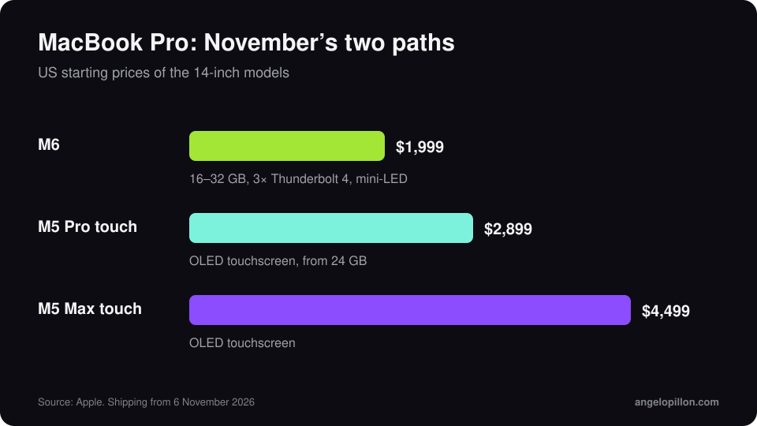

In short
<ul>
<li>14-inch MacBook Pro with M6: 12-core CPU, 16 to 32 GB of memory, three Thunderbolt 4 ports, from $1,999.</li>
<li>Touchscreen MacBook Pro: OLED display, M5 Pro or M5 Max, from $2,899 for the 14-inch.</li>
<li>Both ship with macOS 27 Golden Gate: check your DAW, plug-ins and drivers before using them for paid work.</li>
</ul>

At the end of October Apple announced two MacBook Pro models a day apart. Both have been shipping since 6 November 2026.

<figure><figcaption>US starting prices, 14-inch models. Original graphic.</figcaption></figure>

## M6 MacBook Pro

- 12-core CPU, two more cores than M5.
- 16 to 32 GB of unified memory, up to 170 GB/s of bandwidth.
- 1 TB base storage, three Thunderbolt 4 ports, HDMI, SD slot, headphone jack.
- From $1,999: $400 more than the base M5, with twice the storage.

## Touchscreen MacBook Pro

It is the first Mac with a touchscreen. It uses an OLED panel and the same M5 Pro and M5 Max chips as the March models, which stay on sale. Prices start at $2,899 (14-inch, M5 Pro) and $3,399 for the 16-inch. In Logic Pro the screen works as a keyboard, pads and a control surface.

<!-- SCREENSHOT ANGELO: if you try it, Logic Pro with touch controls -->

## Three checks before you buy

1. **macOS 27 compatibility.** New Macs ship with Golden Gate and normally cannot be downgraded. Pro Tools, for example, does not officially support it yet.
2. **Older plug-ins.** Some still need Rosetta 2, which the system does not install on its own.
3. **A real session on day one.** Open a full project with every plug-in you use, and keep your old Mac ready until everything is confirmed.

## What actually matters for the mix

For mixing and mastering, the processor matters less than people think. Monitoring, the room and the audio interface matter more. Before spending $2,000 on a laptop, read my [home studio budget guide](/home-studio-budget): the upgrade that changes your sound the most is often somewhere else.

<blockquote class="pull">A faster Mac does not make the mix sound better. It makes the wait shorter.</blockquote>

Rather not change computers to finish the record? Send me the tracks and I will handle mixing and mastering. <a class="cta" href="/#contact">Get in touch</a>

## Sources

- [Apple Newsroom](https://www.apple.com/newsroom/)
- [Production Expert, M6 MacBook Pro for audio](https://www.production-expert.com/production-expert-1/apple-m6-macbook-pro-what-audio-pros-need-to-know-before-ordering)
