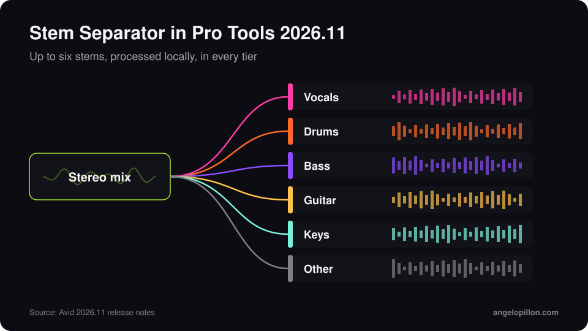

In short
<ul>
<li>Pro Tools 2026.11 was released in early November 2026.</li>
<li>Extensions are a new format, separate from AAX, for tools that run inside Pro Tools without sitting on a track.</li>
<li>The Stem Separator splits a file into up to six stems, runs locally and is included in every tier.</li>
</ul>

Avid previewed Extensions at IBC 2026. Version 2026.11 makes them public, together with built-in stem separation and support for MIDI Polyphonic Expression.

<figure><figcaption>The Pro Tools 2026.11 Stem Separator. Original graphic.</figcaption></figure>

<!-- SCREENSHOT ANGELO: Extensions panel in Pro Tools 2026.11 -->

## What’s new

- **Extensions**: a format for library browsers, collaboration services and automation tools. The first wave includes Avid’s Stem Separator, Pro Sound Effects, Forte, Soundly and Pibox. Splice and SoundFlow now also appear as Extensions.
- **Stem Separator**: up to six stems (vocals, drums, bass, guitar, keys, other), processed on your computer with nothing uploaded. Included in every tier.
- **MPE**: each note in a chord can carry its own pitch, timbre and pressure, with dedicated lanes in the Edit Window and the MIDI editors.
- **Windows**: native scaling for QHD and UHD displays and a dark theme that now covers menus and title bars.
- **Auto-coloured alternate takes**, with an ID that survives playlist edits.

## Availability and requirements

The update is free for subscribers, perpetual licence holders with an active Upgrade Plan and Pro Tools Intro users. It runs on macOS Sonoma 14.8, Sequoia 15.7 and Tahoe 26.6, and on Windows 11. Support for macOS 27 Golden Gate is planned for a later release: if you just bought a new Mac, check before you install.

## What it means for mixing and mastering

Almost every major DAW now has built-in stem separation. For anyone working with clients, the practical consequence is simple: more sessions will arrive with stems pulled out of a stereo mix. They work for a remix or a sketch, much less for a final mix. If you send stems to an engineer, always say whether they were separated from a mix or exported from the original tracks. More on that in my [stem preparation guide](/stem-preparation-guide).

Got a Pro Tools session to mix? Export the tracks and send them over, I will come back with timing and a quote. <a class="cta" href="/#contact">Get in touch</a>

## Sources

- [Avid, Pro Tools: What’s New](https://www.avid.com/pro-tools/whats-new)
- [Production Expert, Pro Tools 2026.11](https://www.production-expert.com/production-expert-1/pro-tools-2026-11-adds-extensions-built-in-stem-separation-and-mpe)
