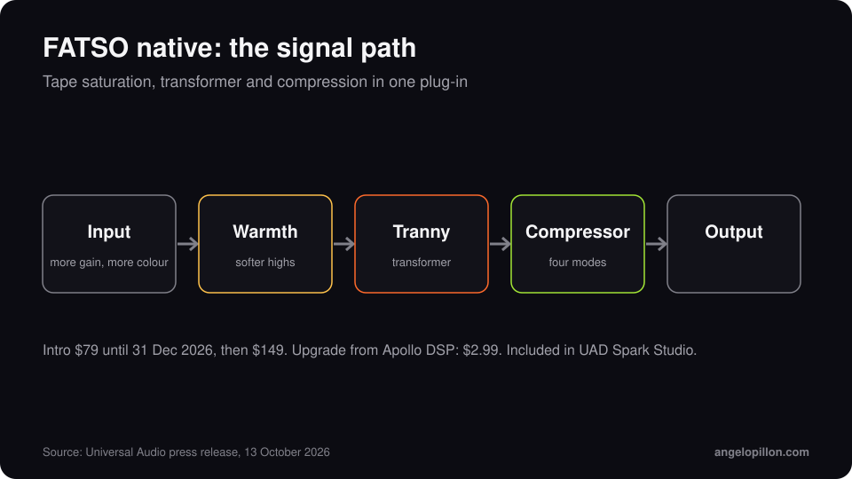

In short
<ul>
<li>On 13 October 2026 Universal Audio released the native Empirical Labs FATSO, with FATSO Jr and FATSO Sr.</li>
<li>No Apollo interface or UAD-2 card needed: it runs on macOS and Windows in any DAW.</li>
<li>Intro price $79 until 31 December 2026, then $149. $2.99 upgrade from Apollo DSP. Included in UAD Spark Studio.</li>
</ul>

The FATSO, Full Analog Tape Simulator and Optimizer, is an Empirical Labs processor designed by Dave Derr. It puts tape-style saturation, transformer colour and compression in one box. Universal Audio developed the plug-in with Derr himself.

<figure><figcaption>The signal path, simplified. Original graphic.</figcaption></figure>

<!-- SCREENSHOT ANGELO: native FATSO on a bus in your session -->

## How it works

- **Input**: the harder you drive it, the more saturation you get. It behaves like soft limiting, without the feel of a conventional compressor.
- **Warmth**: softens the highs the way magnetic tape does when the signal is hot.
- **Tranny**: adds transformer colour, mostly in the low end.
- **Compressor**: four modes, from gentle control to obvious squeeze.

## How I would use it

On a drum bus, with Warmth halfway, it takes the edge off the cymbals and glues kick and snare together. On bass, the transformer helps it read on small speakers. In mastering I use it very carefully: saturation changes the tone of the whole track, and what sounds warm in solo can sound dull next to your references.

If you want to know when saturation helps and when it hurts, I cover it in the article on [saturation in mix and master](/saturation-in-mix-and-master).

<blockquote class="pull">Good saturation goes unnoticed. You notice it when you take it away.</blockquote>

Want a mix with more character without losing dynamics? <a class="cta" href="/#contact">Get in touch</a>

## Sources

- [Universal Audio press release, 13 October 2026](https://www.uaudio.com/blogs/press/now-native-ua-releases-empirical-labs-fatso-tape-simulator-plug-ins)
