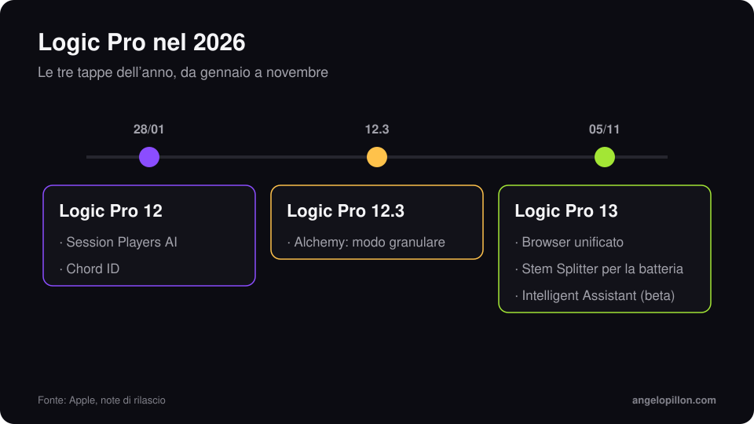

In breve
<ul>
<li>Logic Pro 13 è disponibile dal 5 novembre 2026, gratis per chi ha già Logic e per gli abbonati a Creator Studio.</li>
<li>Le novità principali: browser unificato con tag dei suoni calcolati sul Mac, Stem Splitter che isola i singoli pezzi della batteria, Intelligent Assistant in beta.</li>
<li>Serve un Mac con Apple silicon e macOS 26.1 o successivo.</li>
</ul>

Apple aveva annunciato l’aggiornamento di novembre di Creator Studio il 27 ottobre. Il 5 novembre è arrivato Logic Pro 13, la seconda versione maggiore dell’anno dopo Logic Pro 12 di gennaio.

<figure><figcaption>Le tre tappe di Logic Pro nel 2026. Grafica originale.</figcaption></figure>

<!-- SCREENSHOT ANGELO: Logic Pro 13, browser unificato con i tag dei suoni -->

## Le novità

**Browser unificato.** Loop, campioni, preset e patch si cercano da un unico pannello. Logic analizza i suoni direttamente sul computer e assegna tag automatici, quindi anche le librerie personali diventano ricercabili per carattere e strumento.

**Stem Splitter per la batteria.** La separazione delle tracce non si ferma più a voce, batteria, basso e altro: ora può isolare i singoli elementi della batteria, come cassa, rullante e piatti.

**Intelligent Assistant (beta).** Un assistente basato su AI che risponde a domande e aiuta nelle operazioni in sessione. È incluso solo con l’abbonamento a Creator Studio.

Come ha fatto notare la stampa tedesca di settore, la versione 13 non aggiunge strumenti né effetti nuovi: è un aggiornamento di flusso di lavoro.

<!-- SCREENSHOT ANGELO: Stem Splitter con la batteria divisa in cassa, rullante, piatti -->

## Prezzo e requisiti

| | |
|---|---|
| Uscita | 5 novembre 2026 |
| Acquisto singolo | 199,99 $ |
| Creator Studio | da 12,99 $ al mese |
| Aggiornamento | gratuito per chi ha già Logic Pro |
| Requisiti | Apple silicon, macOS 26.1 o successivo |

## Cosa cambia per mix e mastering

Lo Stem Splitter sulla batteria è utile, ma va usato con giudizio. Se un produttore mi manda un loop di batteria stampato e mi serve più controllo sulla cassa, la separazione è un ottimo punto di partenza. Non sostituisce però le tracce originali: se le hai, mandami quelle. Gli artefatti di separazione, piccoli in cuffia, diventano evidenti quando alzi il volume in mastering.

<blockquote class="pull">Separare una batteria è un salvagente, non un metodo di lavoro. Le tracce originali restano sempre la scelta migliore.</blockquote>

Prima di aggiornare a metà di un progetto, finisci la sessione nella versione in cui l’hai aperta. Controlla i plug-in e fai una copia del progetto: lo stesso consiglio che do per [esportare le tracce per mix e mastering](/it/articoli/esportare-tracce-mix-mastering).

Lavori in Logic e vuoi un mix o un master pronto per le piattaforme? Mandami il progetto o le tracce. <a class="cta" href="/it/#contact">Scrivimi</a>

## Fonti

- [Apple, Logic Pro](https://www.apple.com/it/logic-pro/)
- [Apple Newsroom](https://www.apple.com/it/newsroom/)
