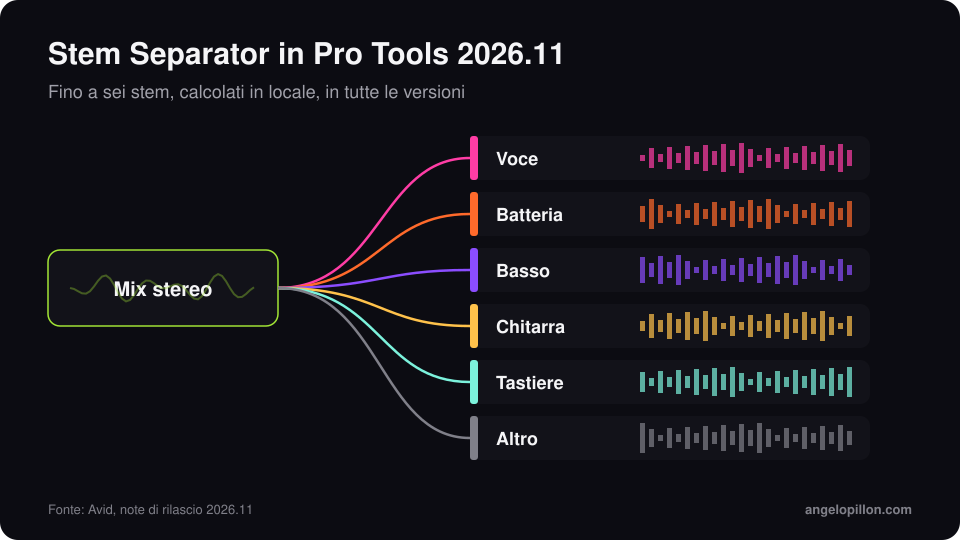

In breve
<ul>
<li>Pro Tools 2026.11 è uscito a inizio novembre 2026.</li>
<li>Le Extensions sono un nuovo formato, separato da AAX, per strumenti che girano dentro Pro Tools senza stare su una traccia.</li>
<li>Lo Stem Separator divide un file in un massimo di sei stem, lavora in locale ed è incluso in tutte le versioni.</li>
</ul>

Avid aveva mostrato le Extensions in anteprima a IBC 2026. Con la versione 2026.11 arrivano nella versione pubblica, insieme a uno separatore di stem integrato e al supporto per il MIDI Polyphonic Expression.

<figure><figcaption>Lo Stem Separator di Pro Tools 2026.11. Grafica originale.</figcaption></figure>

<!-- SCREENSHOT ANGELO: pannello Extensions in Pro Tools 2026.11 -->

## Le novità

- **Extensions**: un formato pensato per browser di librerie, servizi di collaborazione e automazioni. Nella prima ondata ci sono lo Stem Separator di Avid, Pro Sound Effects, Forte, Soundly e Pibox. Anche Splice e SoundFlow ora compaiono come Extensions.
- **Stem Separator**: fino a sei stem (voce, batteria, basso, chitarra, tastiere, altro), calcolati sul computer senza caricare nulla online. È incluso in ogni versione.
- **MPE**: ogni nota di un accordo può avere il suo pitch, timbro e pressione, con corsie dedicate nella Edit Window e negli editor MIDI.
- **Windows**: scaling nativo per schermi QHD e UHD e tema scuro esteso a menu e barre del titolo.
- **Take alternativi colorati in automatico**, con un ID che resta anche dopo le modifiche alle playlist.

## Disponibilità e requisiti

L’aggiornamento è gratuito per gli abbonati, per chi ha una licenza perpetua con Upgrade Plan attivo e per gli utenti di Pro Tools Intro. Gira su macOS Sonoma 14.8, Sequoia 15.7 e Tahoe 26.6, e su Windows 11. Il supporto a macOS 27 Golden Gate è previsto in una versione successiva: se hai appena comprato un Mac nuovo, verifica prima di installare.

## Cosa cambia per mix e mastering

Ora quasi tutte le DAW principali hanno un separatore di stem integrato. Per chi lavora con i clienti, la conseguenza pratica è una: arriveranno più sessioni con stem ricavati da un mix stereo. Funzionano per un remix o per un’idea, molto meno per un mix finale. Se mandi stem al fonico, indica sempre se sono separati da un mix o esportati dalle tracce originali. Ne parlo anche nella guida su [come preparare gli stem](/it/articoli/preparare-gli-stem).

Hai una sessione Pro Tools da mixare? Esporta le tracce e mandamele, ti rispondo con tempi e preventivo. <a class="cta" href="/it/#contact">Scrivimi</a>

## Fonti

- [Avid, Pro Tools: What’s New](https://www.avid.com/pro-tools/whats-new)
- [Production Expert, Pro Tools 2026.11](https://www.production-expert.com/production-expert-1/pro-tools-2026-11-adds-extensions-built-in-stem-separation-and-mpe)
