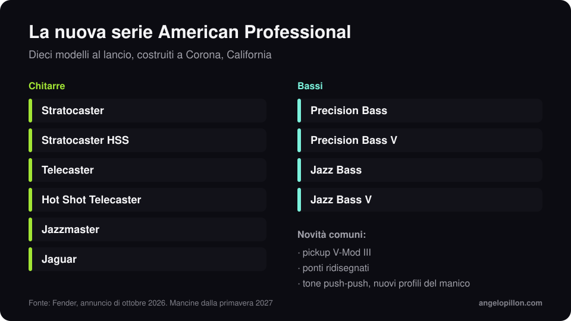

In breve
<ul>
<li>Annunciata a ottobre 2026, la nuova American Professional sostituisce la American Professional II e abbandona la numerazione.</li>
<li>Pickup V-Mod III, ponti ridisegnati, potenziometri ClassicGear Precision, controlli di tono push-push e nuovi profili del manico.</li>
<li>Dieci modelli al lancio, costruiti a Corona, in California. Le versioni mancine arrivano nella primavera 2027.</li>
</ul>

Fender ha deciso di non chiamarla American Professional III. La nuova serie si chiama semplicemente American Professional e prende il posto della II, uscita nel 2020.

<figure><figcaption>La gamma al lancio. Grafica originale.</figcaption></figure>

<!-- SCREENSHOT/FOTO ANGELO: la tua chitarra o il tuo basso in studio, se vuoi -->

## Cosa cambia

- **Pickup V-Mod III**, nuova generazione dei magneti progettati per la serie.
- **Ponti ridisegnati** su tutti i modelli.
- **Potenziometri ClassicGear Precision** e **controlli di tono push-push**, che aggiungono opzioni di suono senza cambiare l’aspetto dello strumento.
- **Profili del manico rivisti.**

## I modelli

Chitarre: Stratocaster, Stratocaster HSS, Telecaster, Hot Shot Telecaster, Jazzmaster e Jaguar. Bassi: Precision Bass, Precision Bass V, Jazz Bass e Jazz Bass V. Tutti costruiti nella fabbrica di Corona, in California.

## Cosa cambia per chi registra

Uno strumento nuovo non migliora un mix da solo, ma alcune cose aiutano davvero chi deve poi mixare:

- **Corde fresche e intonazione controllata.** Un basso stonato sulle note alte è il problema più comune che sistemo nel low end, e nessuna EQ lo corregge.
- **Registra anche un DI pulito.** Con chitarre e bassi chiedo sempre la traccia diretta oltre a quella dell’amplificatore o del simulatore: lascia spazio per scelte diverse in mix.
- **Niente effetti stampati se non sono parte del suono.** Riverbero e delay li gestisco meglio in mix, come spiego nell’articolo su [riverbero e delay](/it/articoli/riverbero-delay-spazio-mix).

<blockquote class="pull">Il pickup nuovo si sente. Un basso intonato male si sente di più.</blockquote>

Hai registrato chitarre e bassi e vuoi un mix che li faccia respirare? <a class="cta" href="/it/#contact">Scrivimi</a>

## Fonti

- [Fender, American Professional](https://www.fender.com/)
