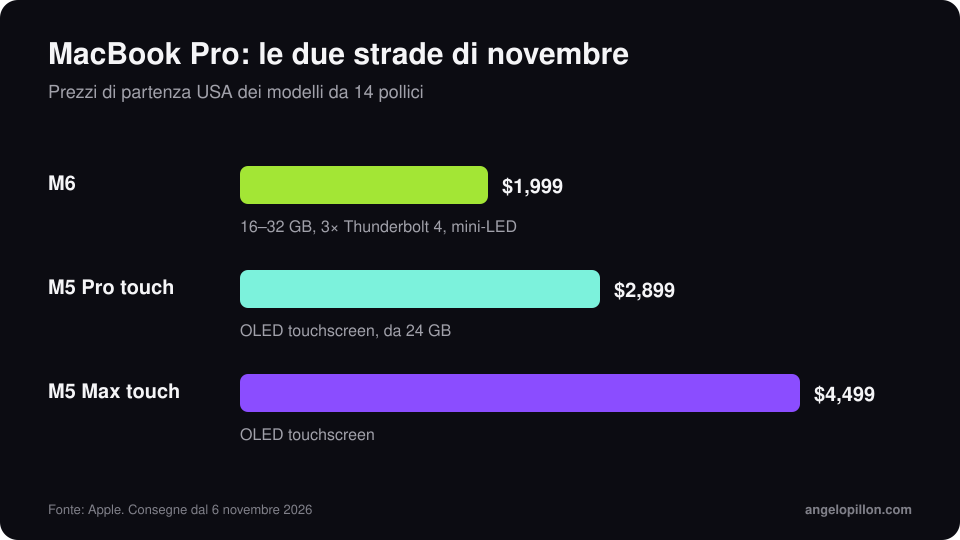

In breve
<ul>
<li>MacBook Pro 14 pollici con M6: CPU a 12 core, da 16 a 32 GB di memoria, tre porte Thunderbolt 4, da 1.999 $.</li>
<li>MacBook Pro touchscreen: schermo OLED, chip M5 Pro o M5 Max, da 2.899 $ nel 14 pollici.</li>
<li>Arrivano con macOS 27 Golden Gate: controlla DAW, plug-in e driver prima di usarli per lavoro.</li>
</ul>

A fine ottobre Apple ha presentato due MacBook Pro a un giorno di distanza. Entrambi sono in consegna dal 6 novembre 2026.

<figure><figcaption>Prezzi USA di partenza, modelli da 14 pollici. Grafica originale.</figcaption></figure>

## MacBook Pro M6

- CPU a 12 core, due in più dell’M5.
- Memoria unificata da 16 a 32 GB, banda fino a 170 GB/s.
- 1 TB di archiviazione di base, tre porte Thunderbolt 4, HDMI, slot SD, jack cuffie.
- Prezzo da 1.999 $: 400 $ in più dell’M5 di base, ma con il doppio dello spazio.

## MacBook Pro touchscreen

È il primo Mac con schermo touch. Usa un pannello OLED e gli stessi chip M5 Pro e M5 Max dei modelli di marzo, che restano in vendita. Parte da 2.899 $ (14 pollici, M5 Pro) e da 3.399 $ nel 16 pollici. In Logic Pro lo schermo si può usare come tastiera, pad e superficie di controllo.

<!-- SCREENSHOT ANGELO: se lo provi, Logic Pro con i controlli touch -->

## Tre controlli prima di comprare

1. **Compatibilità con macOS 27.** I nuovi Mac partono con Golden Gate e di norma non si possono riportare a una versione precedente. Pro Tools, per esempio, non lo supporta ancora ufficialmente.
2. **Plug-in vecchi.** Alcuni hanno ancora bisogno di Rosetta 2, che il sistema non installa da solo.
3. **Una sessione vera il primo giorno.** Apri un progetto completo, con tutti i plug-in che usi, e tieni il vecchio Mac pronto finché non è tutto confermato.

## Cosa conta davvero per il mix

Per mixare e masterizzare, il processore conta meno di quanto si pensi. Contano l’ascolto, la stanza e l’interfaccia audio. Prima di spendere 2.000 € in un portatile, leggi la mia guida al [budget per l’home studio](/it/articoli/budget-home-studio): spesso l’investimento che cambia di più il suono è un altro.

<blockquote class="pull">Un Mac più veloce non rende il mix più bello. Rende l’attesa più corta.</blockquote>

Non vuoi cambiare computer per finire il disco? Mandami le tracce e mi occupo io di mix e mastering. <a class="cta" href="/it/#contact">Scrivimi</a>

## Fonti

- [Apple Newsroom](https://www.apple.com/it/newsroom/)
- [Production Expert, M6 MacBook Pro per audio](https://www.production-expert.com/production-expert-1/apple-m6-macbook-pro-what-audio-pros-need-to-know-before-ordering)
