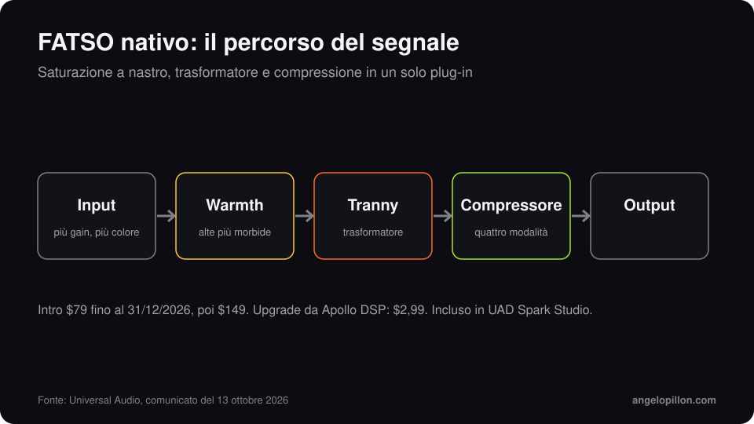

In breve
<ul>
<li>Il 13 ottobre 2026 Universal Audio ha pubblicato la versione nativa dell’Empirical Labs FATSO, con FATSO Jr e FATSO Sr.</li>
<li>Non serve più un’interfaccia Apollo o una scheda UAD-2: funziona su macOS e Windows in ogni DAW.</li>
<li>Prezzo introduttivo 79 $ fino al 31 dicembre 2026, poi 149 $. Upgrade da Apollo DSP a 2,99 $. Incluso in UAD Spark Studio.</li>
</ul>

Il FATSO, Full Analog Tape Simulator and Optimizer, è un processore di Empirical Labs progettato da Dave Derr. Mette in una sola scatola saturazione tipo nastro, colore del trasformatore e compressione. Universal Audio lo ha sviluppato con lo stesso Derr.

<figure><figcaption>Il percorso del segnale, semplificato. Grafica originale.</figcaption></figure>

<!-- SCREENSHOT ANGELO: FATSO nativo su un bus della tua sessione -->

## Come funziona

- **Input**: più spingi, più saturazione ottieni. Si comporta come un limiting morbido, senza la sensazione di un compressore classico.
- **Warmth**: ammorbidisce le alte frequenze come fa il nastro magnetico quando il segnale è caldo.
- **Tranny**: aggiunge il colore del trasformatore, soprattutto sulle basse.
- **Compressore**: quattro modalità, dal controllo leggero alla compressione evidente.

## Come lo userei

Sul bus della batteria, con Warmth a metà strada, toglie l’asprezza dei piatti e tiene insieme cassa e rullante. Sul basso il trasformatore aiuta a farlo sentire anche su altoparlanti piccoli. In mastering lo uso con molta cautela: la saturazione cambia la timbrica dell’intero brano, e quello che sembra caldo in solo può diventare spento accanto alle tracce di riferimento.

Se vuoi capire quando la saturazione aiuta e quando fa danni, ne parlo nell’articolo su [saturazione in mix e mastering](/it/articoli/saturazione-mix-master).

<blockquote class="pull">La saturazione buona non si nota. Si nota quando la togli.</blockquote>

Vuoi un mix con più carattere senza perdere dinamica? <a class="cta" href="/it/#contact">Scrivimi</a>

## Fonti

- [Universal Audio, comunicato del 13 ottobre 2026](https://www.uaudio.com/blogs/press/now-native-ua-releases-empirical-labs-fatso-tape-simulator-plug-ins)
