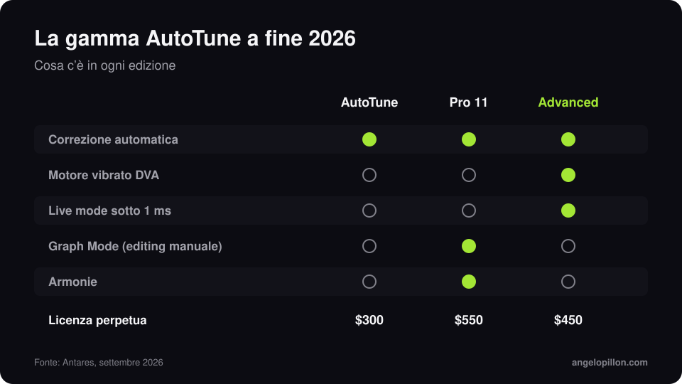

In breve
<ul>
<li>AutoTune Advanced è uscito a fine settembre 2026 ed è il nuovo top della gamma automatica di Antares.</li>
<li>Il motore DVA riconosce il vibrato naturale del cantante e lo preserva anche con correzioni forti. Il Live mode ha una latenza sotto 1 ms.</li>
<li>Costa 450 $ in licenza perpetua. Graph Mode e armonie restano su AutoTune Pro 11.</li>
</ul>

Ad AutoTune si rimprovera da sempre di appiattire la voce: quando la correzione è veloce, anche il vibrato diventa una linea dritta. AutoTune Advanced nasce per risolvere proprio questo.

<figure><figcaption>La gamma AutoTune a fine 2026. Grafica originale.</figcaption></figure>

<!-- SCREENSHOT ANGELO: AutoTune Advanced su una voce, con il display del vibrato -->

## Le novità

- **DVA**: un motore per il vibrato, in attesa di brevetto, che distingue un errore di intonazione da una scelta del cantante. Il vibrato si può preservare, ridurre o accentuare.
- **Live mode**: latenza sotto 1 ms da 44,1 a 192 kHz, utile in registrazione e dal vivo.
- **Formanti e trasposizione**, tastiera visiva a 78 tasti, controllo da MIDI con MIDI Perform e integrazione con AutoKey 2.
- **Preset firmati** da produttori e fonici come Ann Mincieli, Bart Schoudel e David “Yungin” Kim.

## Quale scegliere

| Edizione | Per chi | Prezzo |
|---|---|---|
| AutoTune (2026) | correzione automatica quotidiana | 300 $ |
| AutoTune Pro 11 | editing manuale con Graph Mode, armonie | 550 $ |
| AutoTune Advanced | correzione automatica naturale, live | 450 $ |

Tutte sono incluse nell’abbonamento AutoTune Unlimited.

## Cosa cambia per il mix

Nel rap e nella trap l’AutoTune è parte del suono, e lo tratto come un effetto. In pop e R&B serve invisibile, e lì un vibrato preservato fa una differenza enorme. Un consiglio che vale con qualsiasi versione: mandami sempre anche la voce senza correzione. Se l’intonazione stampata non convince, posso rifarla. Approfondisco nell’articolo sulla [voce rap e trap con l’AutoTune](/it/articoli/voce-rap-trap-autotune).

Hai una voce con AutoTune da mixare? Mandami la traccia corretta e quella pulita. <a class="cta" href="/it/#contact">Scrivimi</a>

## Fonti

- [Antares, AutoTune Advanced](https://www.antarestech.com/)
- [Mix, AutoTune Advanced debuts](https://www.mixonline.com/technology/news-products/autotune-advanced-pitch-correction-plug-in-debuts)
