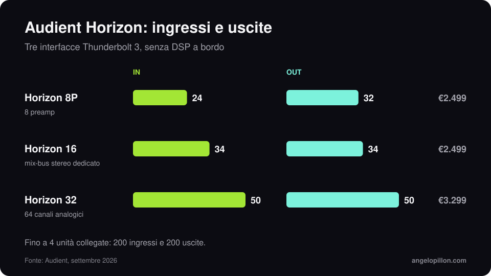

In breve
<ul>
<li>Annunciata il 14 settembre 2026, la serie Horizon è in vendita dal 28 settembre.</li>
<li>Tre modelli Thunderbolt 3: Horizon 8P per la registrazione, Horizon 16 per gli studi ibridi, Horizon 32 per le strutture grandi.</li>
<li>Conversione a 32 bit, latenza di andata e ritorno sotto 1 ms, nessun DSP a bordo. Prezzi da 2.499 € a 3.299 €.</li>
</ul>

Audient la definisce il più grande investimento in ricerca e sviluppo della sua storia. L’idea di fondo: i Mac con Apple silicon sono abbastanza veloci da far girare i plug-in nativi a bassa latenza, quindi un ecosistema DSP proprietario non serve più.

<figure><figcaption>Ingressi e uscite dei tre modelli. Grafica originale.</figcaption></figure>

## I tre modelli

| Modello | I/O | Per chi | Prezzo |
|---|---|---|---|
| Horizon 8P | 24 in / 32 out | registrazione, 8 preamp con impedenza variabile ORBIT e 75 dB di guadagno | 2.499 € |
| Horizon 16 | 34 in / 34 out | studi ibridi, 32 canali su DB25 e percorso dedicato per il mix-bus stereo | 2.499 € |
| Horizon 32 | 50 in / 50 out | grandi studi, 64 canali analogici su otto DB25 | 3.299 € |

Tutti sono in formato rack 1U senza ventole, con richiamo digitale dei guadagni, ingresso e uscita word clock BNC, espansione ADAT e livelli di riferimento selezionabili. Fino a quattro unità si collegano in catena, per un massimo di 200 ingressi e 200 uscite. La garanzia è di tre anni. Il software di controllo è per macOS.

## Cosa significa per il mastering ibrido

Il dettaglio che mi interessa di più è il percorso dedicato per il mix-bus su Horizon 16. Chi lavora con compressori ed equalizzatori analogici in insert ha bisogno di conversione pulita in uscita e in ingresso, e di poter calibrare i livelli con l’outboard. È lo stesso tema dell’articolo su [mastering ibrido e in the box](/it/articoli/mastering-ibrido-vs-itb).

Detto questo, il convertitore non è il collo di bottiglia della maggior parte degli home studio. Prima vengono la stanza e l’ascolto.

<blockquote class="pull">Il convertitore migliore del mondo non corregge una stanza che rimbomba a 80 Hz.</blockquote>

Vuoi un mastering ibrido con catena analogica e controllo digitale? <a class="cta" href="/it/#contact">Scrivimi</a>

## Fonti

- [Audient, Horizon](https://audient.com/)
- [Sound On Sound, Audient Horizon](https://www.soundonsound.com/news/audient-unveil-flagship-horizon-interfaces)
