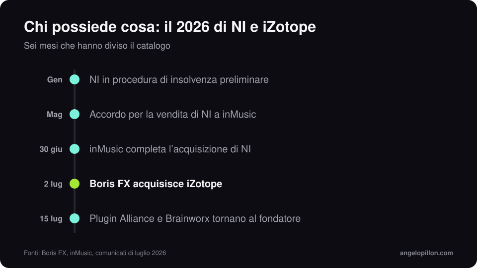

In breve
<ul>
<li>Il 2 luglio 2026 Boris FX ha annunciato l’acquisizione di iZotope.</li>
<li>L’operazione è stata coordinata con l’acquisto di Native Instruments da parte di inMusic, chiuso il 30 giugno.</li>
<li>Licenze, abbonamenti e supporto di Ozone, RX, Neutron e Nectar restano attivi.</li>
</ul>

È stato un anno intenso per uno dei gruppi più grandi del software audio. Native Instruments, che dal 2023 comprendeva iZotope, Plugin Alliance e Brainworx, a gennaio è entrata in una procedura di insolvenza preliminare. A maggio è stato annunciato l’accordo per la vendita a inMusic. Poi il catalogo si è diviso.

<figure><figcaption>Sei mesi che hanno diviso il catalogo. Grafica originale.</figcaption></figure>

## Chi possiede cosa

- **Native Instruments** (Kontakt, Komplete, Maschine): inMusic.
- **iZotope** (Ozone, RX, Neutron, Nectar): Boris FX, che a marzo 2026 aveva già comprato Vegas Pro, Sound Forge e Acid Pro da MAGIX.
- **Plugin Alliance e Brainworx**: dal 15 luglio sono tornate al fondatore di Brainworx, in un nuovo gruppo insieme ad Apogee e Manley.

## Cosa cambia per chi usa Ozone e RX

Per ora niente di pratico. Boris FX e iZotope hanno confermato che licenze e abbonamenti restano attivi e che i team di sviluppo e supporto restano al loro posto. iZotope opera come unità di Boris FX. Gli ultimi prodotti usciti sono RX 12, ad aprile 2026, e Ozone 12, a settembre 2025, con il limiter IRC 5.

Il consiglio che do sempre vale due volte in momenti come questo: tieni da parte gli installer e le chiavi di licenza delle versioni che usi, ed esporta i preset importanti.

## Il mio punto di vista

Ozone è uno strumento eccellente, e l’assistente di mastering è un buon punto di partenza. Ma un plug-in non decide quanto deve suonare forte un brano, né se il basso è troppo per quel genere. Ne parlo in [quanto deve essere forte il master](/it/articoli/quanto-forte-deve-essere-il-master).

Hai provato l’assistente di Ozone e non ti convince? Mandami il premaster, ti dico come lo masterizzerei. <a class="cta" href="/it/#contact">Scrivimi</a>

## Fonti

- [Boris FX, comunicato del 2 luglio 2026](https://blog.borisfx.com/press/boris-fx-acquires-izotope-the-award-winning-leader-in-intelligent-audio-technology)
- [MusicTech, iZotope joins Boris FX](https://musictech.com/news/izotope-joins-boris-fx-exits-native-instruments/)
- [CDM, chi possiede cosa dopo NI](https://cdm.link/ni-after-ni-which-brand-is-where-and-who-owns-whom/)
