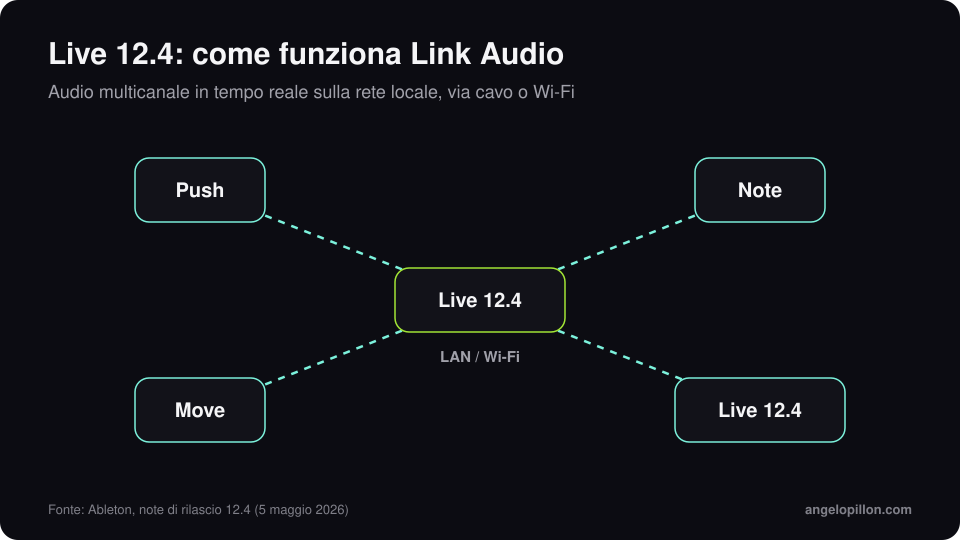

In breve
<ul>
<li>Live 12.4 è uscito il 5 maggio 2026, gratuito per chi possiede Live 12.</li>
<li>Link Audio manda audio multicanale in tempo reale tra dispositivi compatibili sulla rete locale, via cavo o Wi-Fi.</li>
<li>In Live Suite la separazione degli stem lavora su una selezione di tempo e può unire gli stem in una sola clip.</li>
</ul>

Ableton Link sincronizza tempo e fase tra app e dispositivi da anni. Con la versione 12.4 trasporta anche l’audio.

<figure><figcaption>Link Audio sulla rete locale. Grafica originale.</figcaption></figure>

<!-- SCREENSHOT ANGELO: Live 12.4 con Link Audio attivo o la nuova Erosion -->

## Le novità

- **Link Audio**: l’audio di Move, Note, Push o di un altro computer con Live appare come ingresso, senza hardware aggiuntivo e senza compensare la latenza a mano.
- **Separazione degli stem** (Suite): ora lavora su una selezione in Arrangement View, così isolare 16 battute non richiede di processare tutto il brano. Gli stem scelti si possono unire in una sola clip.
- **Dispositivi aggiornati**: Erosion ricostruito, nuovo LFO con modalità di tempo e forme d’onda nel Delay, aggiornamenti a Chorus-Ensemble e Wavetable.
- **Learn View** con lezioni dentro Live e **Quick Tags** nel browser.
- Con 12.4 escono anche **Move 2.0 e Note 2.0**, con tracce audio e Link Audio.

## Cosa cambia per chi manda tracce al mix

La separazione su una selezione è comoda per recuperare un campione da un loop stampato. Ma quando prepari le tracce per il fonico, la regola resta la stessa: esporta dalle tracce originali, con gli effetti creativi stampati e senza processing sul master. Ho scritto una guida su [come preparare gli stem](/it/articoli/preparare-gli-stem), e per il low end della techno quella su [basse e melodic techno](/it/articoli/basse-melodic-techno).

<blockquote class="pull">Gli stem separati da un mix sono un ripiego. Quelli esportati dalla sessione sono un mix che aspetta di nascere.</blockquote>

Produci in Ableton e vuoi un mix pronto per Beatport e Spotify? <a class="cta" href="/it/#contact">Scrivimi</a>

## Fonti

- [Ableton, Live 12.4 è disponibile](https://www.ableton.com/it/blog/live-12-4-is-out-now/)
- [Ableton, What’s new in Live 12.4](https://help.ableton.com/hc/en-us/articles/26963870210076-What-s-new-in-Live-12-4)
