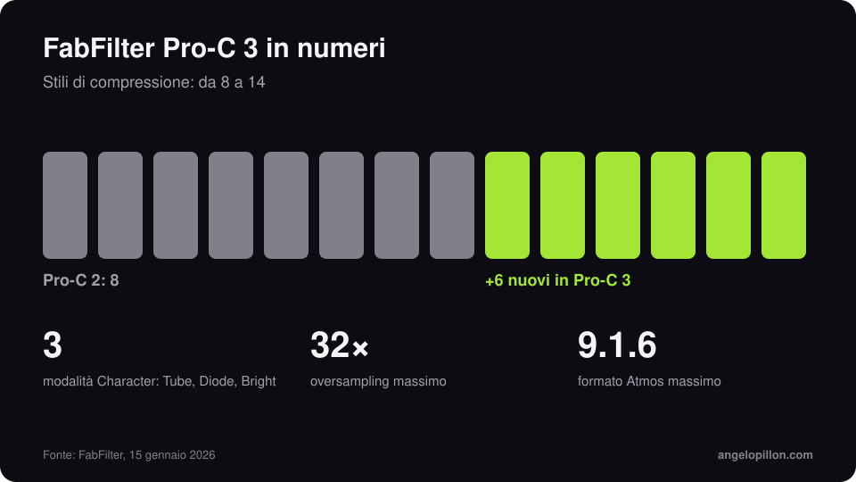

In breve
<ul>
<li>Pro-C 3 è uscito il 15 gennaio 2026.</li>
<li>Sei stili nuovi, per un totale di 14, e tre modalità Character: Tube, Diode e Bright.</li>
<li>Auto Threshold, oversampling fino a 32x, supporto Atmos fino a 9.1.6. Prezzo 169 €.</li>
</ul>

Pro-C 2 è stato per anni il compressore “di default” in tantissime sessioni: trasparente quando serve, con stili diversi per voce, bus e mastering. Pro-C 3 mantiene l’interfaccia e allarga le possibilità.

<figure><figcaption>Pro-C 3 in numeri. Grafica originale.</figcaption></figure>

<!-- SCREENSHOT ANGELO: Pro-C 3 su un bus o una voce della tua sessione -->

## Le novità

- **14 stili** di compressione, sei in più rispetto a Pro-C 2.
- **Character**: tre modalità di saturazione, Tube, Diode e Bright, per aggiungere colore direttamente nel compressore.
- **Auto Threshold**: la soglia segue il livello del segnale, utile per tenere costante la compressione mentre cambi il guadagno in ingresso.
- **Oversampling fino a 32x** e **supporto Atmos fino a 9.1.6**.
- Nello stesso periodo Pro-Q 4.10 ha aggiunto la Instance List, per vedere e modificare tutte le istanze aperte in una sola finestra.

## Come lo uso

Sulla voce, uno stile veloce e Auto Threshold attivo mi permettono di cambiare il guadagno senza rifare il bilanciamento della compressione. Sul mix bus preferisco uno stile lento, con pochi dB di riduzione: per i dettagli c’è l’articolo sulla [compressione del bus](/it/articoli/compressione-bus-mix). Le modalità Character sono comode, ma attenzione: aggiungono armoniche, e in un mix dove saturi già altrove si accumulano.

<blockquote class="pull">Un compressore nuovo non risolve una voce compressa male. Ma uno buono fa sembrare facile una voce compressa bene.</blockquote>

Vuoi una voce presente e controllata senza suono schiacciato? <a class="cta" href="/it/#contact">Scrivimi</a>

## Fonti

- [FabFilter, Pro-C 3](https://www.fabfilter.com/)
