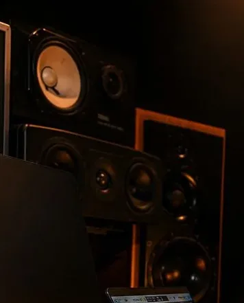

In breve
<ul>
<li>Lossless significa che il file non perde informazioni rispetto all’originale. È il contrario dell’MP3 e dell’AAC, che tagliano dati per pesare meno.</li>
<li>Spotify offre il lossless agli abbonati Premium da settembre 2025, fino a 24 bit/44,1 kHz in FLAC, senza costi aggiuntivi.</li>
<li>Apple Music e Tidal arrivano fino a 24 bit/192 kHz. Per sentire la differenza servono però cuffie o casse collegate bene: con il Bluetooth classico il lossless non arriva.</li>
</ul>

Ogni giorno passo ore ad ascoltare la stessa canzone in formati diversi, dal file del master alla versione compressa dello streaming. La differenza esiste, ma non sempre dove pensi.

<figure class="fig-small"><figcaption>In studio ascolto il master in qualità piena, prima che arrivi alle piattaforme. Foto dello studio.</figcaption></figure>

## Cosa vuol dire lossless

Un file “compresso con perdita” come MP3 o AAC elimina le parti del suono che, secondo un modello dell’udito, sentiresti meno. Un file lossless, come FLAC o ALAC, si comprime come un archivio zip: pesa meno dell’originale, ma quando lo riproduci è identico bit per bit.

## I servizi a confronto

| | Qualità massima | Costo extra |
|---|---|---|
| Spotify Premium | 24 bit/44,1 kHz, FLAC | nessuno |
| Apple Music | 24 bit/192 kHz (Hi-Res Lossless), ALAC | nessuno |
| Tidal | 24 bit/192 kHz, FLAC | incluso nell’abbonamento |

Spotify ha iniziato a distribuire il lossless il 10 settembre 2025, in più di 50 mercati entro ottobre. Va attivato a mano su ogni dispositivo, nelle impostazioni della qualità audio. Su Apple Music il Lossless va da 16 bit/44,1 kHz a 24 bit/48 kHz; oltre i 48 kHz si parla di Hi-Res Lossless, che richiede un convertitore esterno.

## Si sente?

Il salto più grande non è tra lossless e hi-res, ma tra un ascolto distratto e uno attento. La qualità CD, 16 bit/44,1 kHz, va già oltre quello che la maggior parte delle persone riesce a percepire. Quello che conta di più:

- **Il collegamento.** Il Bluetooth non ha abbastanza banda per il FLAC: con le cuffie wireless più comuni il lossless non arriva intero.
- **Le cuffie o le casse.** Un buon paio di cuffie con il filo fa più differenza di qualsiasi formato.
- **Il master.** Un brano mixato e masterizzato bene suona bene anche in AAC. Uno fatto male resta fatto male anche in hi-res.

<blockquote class="pull">Il formato conta. Ma conta di più quello che c’è dentro il file.</blockquote>

Se ti interessa capire cosa succede tra lo studio e il tuo telefono, ho scritto una guida su [cuffie Bluetooth e codec](/it/articoli/cuffie-bluetooth-qualita-audio-codec) e una sul [perché il volume cambia tra una canzone e l’altra](/it/articoli/perche-il-volume-cambia-tra-le-canzoni).

Sei un artista e vuoi che il tuo brano suoni al meglio su ogni piattaforma? Il master lo preparo io. <a class="cta" href="/it/#contact">Scrivimi</a>

## Fonti

- [Stereophile, Spotify Premium lossless](https://stereophile.com/content/spotify-premium-finally-gets-lossless-audio)
- [Android Authority, Spotify Lossless](https://www.androidauthority.com/spotify-premium-lossless-audio-rollout-3596456)
- [MacRumors, Apple Music Lossless e Spatial Audio](https://www.macrumors.com/2021/05/17/apple-music-spatial-audio-announced/)
