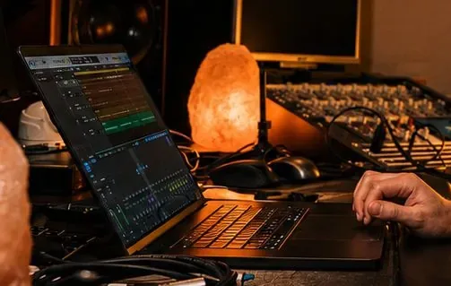

In breve
<ul>
<li>Spotify non paga “a stream”: circa il 70% dei ricavi va ai titolari dei diritti, diviso in proporzione agli ascolti.</li>
<li>La cifra che si sente più spesso è tra 0,003 e 0,005 dollari a stream, ma è una media che cambia con il paese e il tipo di abbonamento.</li>
<li>Da aprile 2024 un brano deve fare almeno 1.000 stream in 12 mesi per generare i diritti sulla registrazione.</li>
</ul>

Ricevo questa domanda quasi da ogni artista con cui lavoro. Ecco come funziona, senza miti.

<figure class="fig-small"><figcaption>Dietro ogni stream c’è un file che qualcuno ha preparato con cura. Foto dello studio.</figcaption></figure>

## Come si divide il denaro

Abbonamenti e pubblicità finiscono in un unico fondo. Spotify ne trattiene circa il 30% e il resto va a etichette, distributori ed editori, in base a quanto è stato ascoltato ogni brano: se una canzone fa l’1% degli stream di un periodo, riceve l’1% del fondo. È il cosiddetto modello pro rata.

I soldi non arrivano direttamente all’artista: passano dall’etichetta o dal distributore, che applica il proprio contratto.

## La soglia dei 1.000 stream

Dal 2024 un brano deve superare i 1.000 stream negli ultimi 12 mesi, con un numero minimo di ascoltatori diversi, per partecipare ai diritti sulla registrazione. Spotify non dice quale sia quel numero minimo. La soglia non riguarda i diritti editoriali di autori ed editori, che continuano a essere pagati.

## E allora, quanto?

| Stream | Stima a 0,004 $ |
|---|---|
| 1.000 | circa 4 $ |
| 100.000 | circa 400 $ |
| 1.000.000 | circa 4.000 $ |

È una stima indicativa, prima di quello che trattengono etichetta o distributore. Il dato reale lo trovi solo nei rendiconti. Secondo i dati diffusi da Spotify, nel 2025 più di 13.800 artisti hanno incassato almeno 100.000 dollari dalla piattaforma.

<blockquote class="pull">Lo streaming paga chi viene ascoltato tante volte. E una canzone viene riascoltata quando suona bene.</blockquote>

Gli stream non dipendono solo dal suono, ma un brano che regge il confronto con quelli che gli stanno intorno in playlist parte avvantaggiato. Se stai per pubblicare, leggi anche come [pubblicare la tua prima canzone su Spotify](/it/articoli/come-pubblicare-la-prima-canzone-su-spotify).

Prima di investire in promozione, assicurati che il brano suoni come quelli con cui compete. <a class="cta" href="/it/#contact">Scrivimi</a>

## Fonti

- [Shopify, come guadagnare con Spotify](https://www.shopify.com/in/blog/how-to-make-money-on-spotify)
- [RouteNote, la soglia dei 1.000 stream](https://routenote.com/blog/spotify-to-still-pay-publishing-royalties-below-1k-streams/)
- [Get More Streams, quanto paga Spotify](https://getmorestreams.com/?p=10571)
