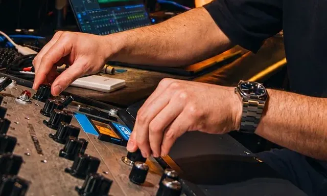

In breve
<ul>
<li>Le fasi sono sei: scrittura, produzione, registrazione, mix, mastering, pubblicazione.</li>
<li>Il mix mette in equilibrio gli strumenti tra loro; il mastering prepara il brano finito per il mondo.</li>
<li>Ogni fase dipende da quella prima: un problema lasciato indietro si paga dopo.</li>
</ul>

Io lavoro nelle ultime due fasi tecniche, mix e mastering. Ogni settimana vedo arrivare brani in tutti gli stati, e la differenza tra un pezzo che decolla e uno che fatica si decide spesso molto prima di arrivare da me.

<figure><figcaption>Il mix: il momento in cui le parti diventano una canzone. Foto dello studio.</figcaption></figure>

## 1. Scrittura

Melodia, accordi, testo. Una buona canzone si regge anche suonata con una chitarra sola. Se in questa forma non funziona, nessun suono la salverà.

## 2. Produzione

Si decide il vestito: che strumenti, che ritmo, che atmosfera. Il produttore costruisce l’arrangiamento e sceglie i suoni.

## 3. Registrazione

Voci e strumenti vengono registrati. Qui conta catturare bene la performance: un microfono giusto e una stanza buona valgono più di qualsiasi correzione dopo.

## 4. Mix

Il fonico di mix mette ogni elemento al suo posto: volume, timbro, spazio, profondità. È il momento in cui le singole tracce diventano un brano unico. Ne parlo nell’articolo sulla [differenza tra mix e mastering](/it/articoli/differenza-mix-mastering).

## 5. Mastering

L’ultimo controllo di qualità. Il master rifinisce il timbro, porta il volume al livello giusto per le piattaforme e fa in modo che il brano suoni bene in cuffia, in macchina e in club. Per un album rende coerenti tutti i brani.

## 6. Pubblicazione

Il file finale va a un distributore, che lo consegna a Spotify, Apple Music e agli altri servizi.

| Fase | Chi la fa | Domanda chiave |
|---|---|---|
| Scrittura | autore | funziona chitarra e voce? |
| Produzione | produttore | che suono deve avere? |
| Registrazione | fonico, musicisti | la performance è catturata bene? |
| Mix | fonico di mix | ogni cosa è al suo posto? |
| Mastering | fonico di mastering | suona bene ovunque? |
| Pubblicazione | artista, distributore | arriva alle persone giuste? |

<blockquote class="pull">Ogni fase può migliorare quella prima. Nessuna può sostituirla.</blockquote>

Hai finito la produzione e vuoi chiudere il brano? Mix e master li faccio io, con catena analogica. <a class="cta" href="/it/#contact">Scrivimi</a>

